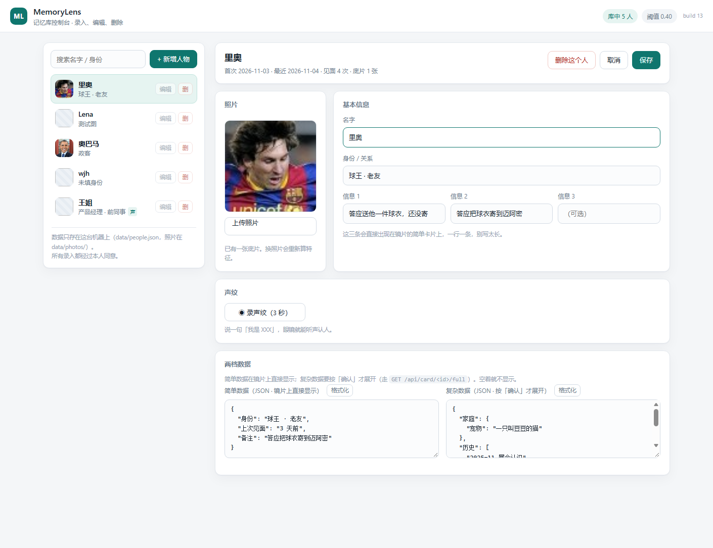
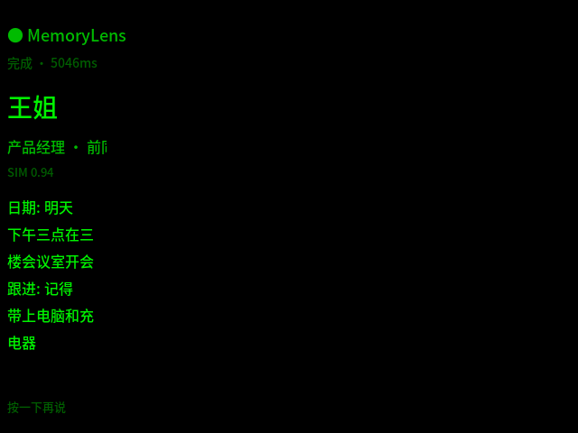

# MemoryLens · 记忆眼镜

**[使用说明](使用说明.md)** · **[开发者文档](开发者文档.md)** · **[多人会议测试与教程](docs/20-任务二测试与教程.md)** · [IrisView 工具包](docs/07-IrisView-工具包.md)

> 见一个人，聊两句，眼镜里浮出：他是谁、上次聊到哪、你答应过他什么、这次该做什么。

灵感来自《神探夏洛克》第三季的 Magnussen——但把「偷看别人的秘密」换成了 **「记住我自己的人脉」**。
数据全部来自你本人录入、且经过对方同意。

**只有一条通道：声音。** 眼镜天生有麦克风，戴着不用抬手，说一句话就能认人；
前 15 秒它自动认人并把档案放到镜片上；之后你觉得该接话了，按一次确认，它给你三条能直接说出口的提词；按返回整段入库。

仓库：<https://github.com/1008wjh/heikesong-ar-wjh123456>

---

## 文档导航

| 文档 | 看它做什么 |
|---|---|
| **[使用说明](使用说明.md)** | 上手就跑：装什么、控制台怎么录人、眼镜怎么用、三分钟演什么、故障表 |
| **[开发者文档](开发者文档.md)** | 协作开发：架构图、数据模型、22 个接口、智能体节点、眼镜端限制、测试与坑 |
| **[多人会议测试与教程](docs/20-任务二测试与教程.md)** | 任务 2 的五分钟跑通、五状态/四布局、文本指令、2/3 人确认、API 手工验证、排错与验收矩阵 |
| [IrisView 工具包](docs/07-IrisView-工具包.md) | 亮亮视野开发包：命令、本机踩的坑、我们怎么接 |

```powershell
git clone git@github.com:1008wjh/heikesong-ar-wjh123456.git
cd heikesong-ar-wjh123456
双击 start.bat
```

`models/` 里已带两个模型（声纹 27MB + 本地转写 82MB 可选下），**不用另外找**。

---

## 它到底怎么工作

```
   眼镜（640×480 mono）                服务器（Python :8765）              控制台（浏览器）
  ┌──────────────────┐   15s/55s 一片  ┌──────────────────────────┐      ┌──────────────┐
  │ 选 单人 / 多人     │ ────────────▶ │ POST /api/agent/feed      │      │ 01 人物数据   │
  │ 录音、切片        │                │  LangGraph 智能体：        │ ◀─── │ 02 对话分析   │
  │ 每 700ms 拉一次   │ ◀──────────── │  ingest→route→identify    │      │ 增删改查      │
  │ 卡片 / 详情 / 键盘 │   同一份 view  │  →extract→recommend      │      │ 声纹 / JSON  │
  └──────────────────┘                │  →render→commit          │      └──────────────┘
                                       │ 声纹 CAM++ / LLM / 人脉库   │
                                       └──────────────────────────┘
```

- **眼镜不推理**：它只切音频、发请求、把返回的几行字画上去。
- **一次对话是一张图**：节点都在 `src/agent.py`，中间状态可查、可回放。
- **模型是可选件**：没配 Key 就降级到关键词规则，界面会标「兜底」，功能不崩。

### 眼镜上的五个动作

平台只给 6 个离散输入（上/下/左/右/确认/返回），没有双击和长按。所以：

| 屏幕上现在是什么 | 按「确认」 | 按「返回」 |
|---|---|---|
| 空 | 出「单人 / 多人」两个按钮 | — |
| 选模式 | 开始听（一直录） | 退回上一步 |
| 在听 | 把这段交给智能体 → 三条提词（停 20 秒） | **结束这段**：收尾 → 析出 → 入库 |
| 在听 | 同一个人，可以反复按 | — |

另外两个键：`↑` 短语键盘（不用说话也能下指令），`↓` 三条 AI 建议。

### 为什么是「先选单人/多人」

第一个节点故意不做推理——让人自己说这一场是什么，比让模型猜更准、也更快。
选「多人」进入独立会议图：本地分人 + 逐段转写 + 待办/建议/归档；首片 15 秒、之后每 55 秒自动切片，全程免手操作。选「单人」则立刻开录。

---

## 控制台（两个模块）



**01 人物数据**：搜 / 加 / 改 / 删。字段是 **照片（可选）、名字、身份（关系）、信息 1/2/3**，
再加两个 JSON 框：**简单数据**（镜片上直接显示）与 **复杂数据**（按「确认」才展开，`GET /api/card/<id>/full` 按需拉）。
录过声纹的人带一个青色「声」标；只填名字也能建。

**02 对话分析**（单人）：锁定一个人 → 录音或粘文本 → 大模型析出「答应了什么 / 偏好 / 近况」→
每条带原话，**你勾选后**才写进他的档案。


转写与析出是两条线，因为厂商能力不对等（DeepSeek 有对话、没有语音识别）：

```powershell
# 转写：本地 paraformer（不要 Key）
powershell -File tools\get_asr_model.ps1
# 析出：DeepSeek
set DEEPSEEK_API_KEY=sk-...
set AR_LLM_PRESET=deepseek
```

---

## 眼镜上长什么样

真实模拟器 mono 输出，单色绿，640×480。镜片上一个 `Text` 只画得出约 110px，
所以 HUD 是窄列、每行 6 个汉字以内，超一屏自动轮播。



按「确认」翻详情（复杂数据）：


按 `↑` 调短语键盘，`↓` 看建议：


---

## 目录

| 路径 | 作用 |
|---|---|
| `src/agent.py` | LangGraph 智能体：判单人/多人、认人、抽要点、出建议、渲染、入库 |
| `src/llm.py` | ASR（本地 paraformer / HTTP）+ chat（DeepSeek / MiMo / OpenAI 兼容） |
| `src/voice.py` | 声纹：CAM++ 192 维、双阈值 0.72 + 间隔 0.08 |
| `src/store.py` | 人脉库 JSON：`simple` / `complex` / `voice_embeddings` / `conversations` |
| `src/cards.py` | 把两档数据摊平成"眼镜能画的行" |
| `src/server.py` | stdlib HTTP 服务，22 个接口（主链路 + 控制台 + 调试） |
| `glasses/` | FusionUI 应用（`index.js` + `outbox.js` + `FusionUIApp.json`） |
| `web/` | 控制台（原生 JS，无框架） |
| `test/` | 智能体 / 声纹 / 接口 / 控制台 / 眼镜端仿真等七套测试 |
| `deploy/` | 两个镜像（后端、工具链）+ 模拟器脚本 |
| `tools/` | `kit-docker.ps1`（打包/跑模拟器）、`try_voice.py`、`get_asr_model.ps1` |
| `examples/` | 三张公开示例图；真实数据在 `data/`，不进仓库 |
| `dist/memorylens.fuiapp` | 打好的眼镜包（3.1.0 / versionCode 66） |

---

## 做到哪一步了

- **识别**：声纹 192 维，同人异句 0.82–0.94、异人 0.20–0.67，单句 20–50ms（CPU）
- **智能体**：单人全链路跑通（认人 → 抽要点 → 建议 → 入库），模型挂了自动降级
- **眼镜端**：模式选择、持续听（15s/55s 切片）、卡片/详情、短语键盘、建议、离线补传，全部在真模拟器里跑过
- **控制台**：人物 CRUD + 声纹录入 + 两档 JSON + 单人对话分析
- **多人会议**：独立会议图（分人 → 跨切片质心匹配 → 逐段 ASR → 待办 → 归档），眼镜端五状态 + 四种布局 + 文本指令，详见 [docs/20](docs/20-任务二测试与教程.md)
- **容器化**：后端与工具链两个镜像，模拟器能在容器里真跑

---

## 三分钟演示

1. **开录**：确认 → 选「单人」→ 确认，开始一直录
2. **认人**：第 15 秒自动切一片 → 镜片上是数据库里的他：「王姐 / 产品经理 · 前同事 / 答应下周给报价单 / 养了一只叫豆豆的猫」
3. **提词**：按一次确认 → `在想…` → 三条能直接说出口的话，停在页面上 20 秒
4. **再来**：再说一段，再按确认，提词会换（每次都会拼上他的档案）
5. **入库**：按返回 → 「已记入 王姐 · N 条」，控制台档案里多一段对话
6. **打字**：按 `↑` → 短语键拼一句 → 发送 → 眼镜内容跟着变

---

## 多人会议模式

> 以工作区文档和代码为准，细节见 **[docs/27-会议模式可行方案.md](docs/27-会议模式可行方案.md)**。
> 旧的 PRD 实现记录 docs/26 已标记废弃。

主界面按确认 → 左/右选「多人」→ 确认进入会议模块（未录制）：

| 按键 | 作用 |
|---|---|
| 确认 | 开始 / 停止录制 |
| 左 | AI 回答：打开/刷新；回答过长只显示结论 + 关键词 + 短要点 |
| 右 | 关闭 AI 回答文字 |
| 上 | 短语键盘：文字提问 / 文本指令 |
| 下 | 当前 options（四布局指令） |
| 返回 | 停止（若在录）→ 关回答 → 退出 |

- **不做底部实时字幕**；说话人分段仍在后台转写与 AI 上下文里；
- 右上角常驻「● 录制中 / ○ 未录制」；
- 原始音频：`audio_storage/<session>.pcm`；会议记录/总结：`data/meetings.db` + `data/meetings/agent_<session>/meta.json`
- 控制台「03 多人会议」：历史列表、完整转写、AI 问答历史、会议总结、离线说话人归集；
- 没配大模型 Key 时，AI 回答/总结走本地规则兜底并标注「兜底」；补 `DEEPSEEK_API_KEY` 后自动升级；
- 一键启动模拟器：双击 `sim.bat`（自动起后端、增量打包、用 WSLg 开模拟器窗口）。

---

## 已知限制

- 眼镜端没有摄像头 API（kit 全量字节扫过，`/dev/video` / `v4l2` 零命中），所以**不做人脸识别**；
  `/api/scan` 与 `tools/try_face.py` 只留作电脑端调试
- 多人会议的分人是本地 pyannote + CAM++；短促抢话/重叠说话仍可能并成同一人，演示时尽量轮流说
- 会议待办目前是关键词规则版，不是大模型语义抽取；没有明确“谁、做什么、什么时候”时可能为 0 条
- 语音建议可能跑偏，所以要点必须人工勾选才入库
- `test/glasses_sim.js` 偶发飘红：它同时当假麦克风、按键驱动和断言，ASR+LLM 有 2–4 秒抖动

---

## 许可

MIT。模型各自遵循原许可（CAM++ / paraformer / YuNet / ArcFace）。
