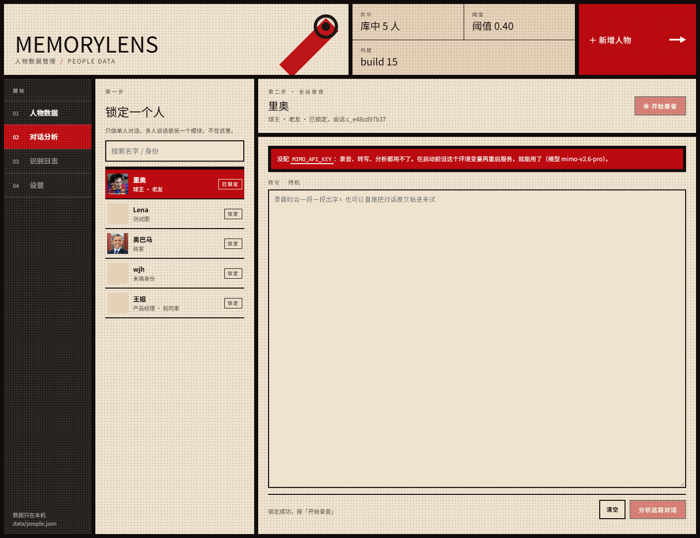
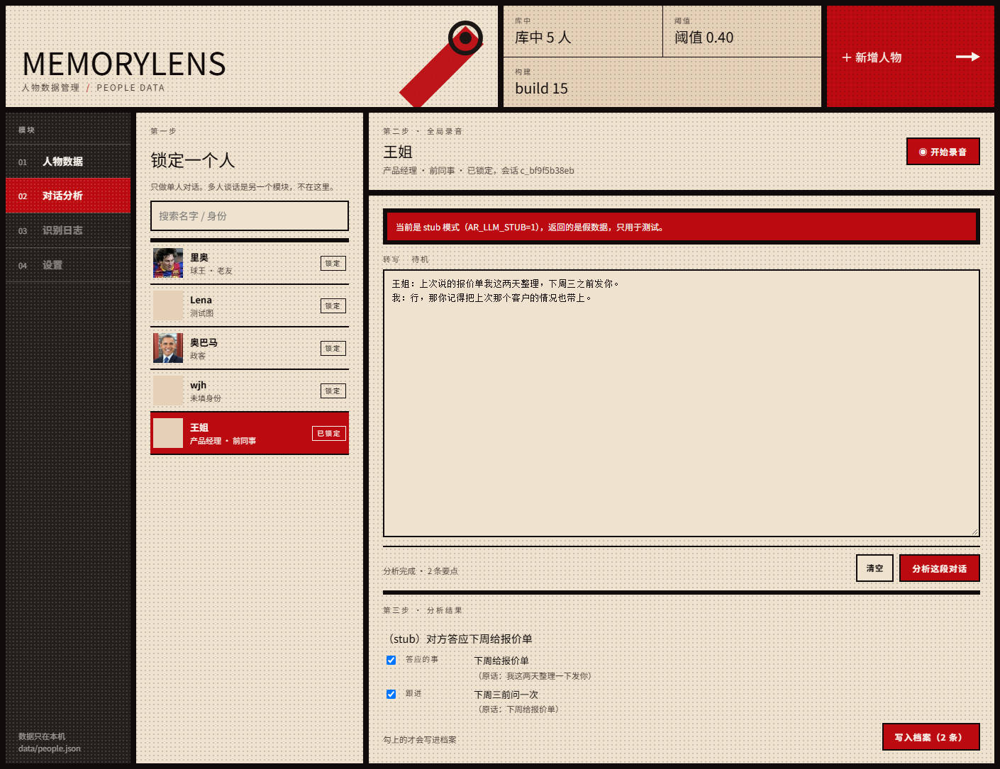

# MemoryLens · 记忆眼镜

**[使用说明](使用说明.md)** · **[开发者文档](开发者文档.md)** · [IrisView 工具包](docs/07-IrisView-工具包.md)

> 见一个人，打个招呼，眼镜里浮出：他是谁、上次聊了什么、你答应过他什么。

灵感来自《神探夏洛克》第三季的 Magnussen——但把「偷看别人的秘密」换成了
**「记住我自己的人脉」**。数据全部来自你本人录入、且经过对方同意。

**主通道是声纹**：眼镜天生有麦克风，戴着不用抬手，说一句话就能认人；
人脸是第二条通道（手机/电脑拍一张），两条通道出**同一种卡片**。

仓库：<https://github.com/1008wjh/heikesong-ar-wjh123456>

## 文档导航

| 文档 | 看它做什么 |
|---|---|
| **[使用说明](使用说明.md)** | 上手就跑：三条路（只看效果 / 跑模拟器 / 真机）、控制台、3 分钟演示、故障表 |
| **[开发者文档](开发者文档.md)** | 协作开发：架构、数据模型、13 个接口、识别管线、7 条坑、扩展指南 |
| [IrisView 工具包](docs/07-IrisView-工具包.md) | 亮亮视野开发包：命令、本机踩的坑、我们怎么接 |

```powershell
git clone git@github.com:1008wjh/heikesong-ar-wjh123456.git
cd heikesong-ar-wjh123456
```

克隆下来 `models/` 里已经有三个模型（人脸两个 + 声纹一个，共约 41MB），**不用另外下**。
只有亮亮视野的开发包不在仓库里（400+MB），见 `docs/07`。

---

## 30 秒跑起来

### 路线一：声纹（推荐，也是演示主线）

```powershell
pip install opencv-python-headless onnxruntime numpy sherpa-onnx
python src/server.py        # 打开 http://127.0.0.1:8765
```

1. 右侧控制台点「+ 新增」→ 传张照片、填名字身份 →（可选）点「◉ 录声纹（3 秒）」说"我是 XXX" → 保存。
2. 起来眼镜端：模拟器见 `docs/00` 的路线 B；不想开模拟器就 `node test/glasses_sim.js`，它会真打后端、断言"镜片上会写出什么字"。
3. 镜片空屏时按一下「确认」→ 开始录音 → 说完自动停 → 认出后浮出卡片，状态行写「听到 · 53ms」。
4. 再按「确认」翻详情页（复杂数据），「返回」清屏。

### 路线二：用一张照片验人脸通道（不需要摄像头）

控制台现在**只管数据**（没有摄像头按钮了）。识别通道用命令行验，一条命令出一个结果：

```powershell
python tools\try_face.py test\messi5.jpg     # known 里奥 sim=1.000
python tools\try_face.py test\biden.jpg      # unknown 陌生人
```

人脸通道的接口没变（`POST /api/scan`），手机端或别的采集端照样能接。

---

## 为什么是这个方向

**原方案的问题**：照片 → 云端数据库比对 → 召回"这个人的信息"。
听起来酷，但有两个硬伤：

1. **数据从哪来**。公开人脸的"数据库检索"三天做不出来，做出来也不敢用（《个人信息保护法》）。
   评委第一个问题就是"你哪来的数据"。
2. **没有闭环**。认出来之后呢？显示一条维基百科式的简介，看完就没了。

**改成一个闭环**：认人 → 回忆 → 提醒 → 记录。

- 认人：你见过的人，**说一句话**就认出来（本地 192 维声纹，不联网；也可以拍一张脸，512 维）
- 回忆：上次什么时候见的、聊了什么、你答应过他什么
- 提醒：**"你答应把球衣寄给他——还没寄"**，这是最抓人的一秒
- 记录：聊完说一句"记一下，他下周三来杭州"，这条就进他的档案，下次自动浮出来

也就是说，它不只是"查"，它还会"写"。这才像个 agent，而不是一个玩具识别器。

---

## 架构

```
   眼镜（640×480 mono）                  电脑 / 云（Python，本地优先）
  ┌────────────────────┐   WAV 16k    ┌───────────────────────────────┐
  │ 按一下「确认」录音  │ ───────────▶ │ POST /api/voice/scan           │
  │                    │              │   voice.py  CAM++ → 192 维      │
  │ 每 700ms 拉一次     │ ◀─────────── │   store 匹配 → cards 出卡片     │
  │ GET /api/latest    │  JSON 卡片    │ GET /api/card/<id>/full  详情   │
  └────────────────────┘              │ POST /api/scan  （人脸通道）    │
            ▲                         │   face.py  YuNet → ArcFace 512  │
            │                         │                                │
   手机/电脑抓一拍 ───────────────────▶ │ 控制台：增删改查 / 录声纹       │
                                       └───────────────────────────────┘
```

关键点：

- **两条识别通道，一套卡片**。声纹走 `/api/voice/scan`，人脸走 `/api/scan`，结果都写成同一种卡片塞进 `/api/latest`，眼镜端只认卡片。
- **两档数据**。每个人有 `simple`（镜片上直接显示）和 `complex`（按「确认」才拉）。`simple` 随卡片下发，`complex` 走 `GET /api/card/<id>/full` 按需拉 —— 既是省流，也是隐私闸门。
- **为什么主用声纹**：眼镜有麦克风（`input.audio`，16kHz 单声道 20ms 一帧），SDK 里却没有任何摄像头 API；戴着眼镜"打个招呼"比举手机对脸自然得多。
- **回显是拉，不是推**。眼镜没有服务器能力，只能每 700ms 拉 `/api/latest`，靠 `rev` 自增号判断要不要重画（平均 350ms 延迟，换来断线自愈）。
- **不依赖任何 AR 硬件**。眼镜只是个显示器，识别在"云"上（演示时就是这台笔记本）。
- **全本地、无外网**。人脸模型 13MB + 232KB，声纹模型 28MB，CPU 单帧/单句 ~20–130ms。现场断网照样跑。
- **数据是一个 JSON**。`data/people.json`，出问题用记事本就能改。

### 眼镜上的三个动作

平台只给 6 个离散输入（上/下/左/右/确认/返回），没有双击和长按。所以整台眼镜就三个动作：

| 屏幕上现在是什么 | 按「确认」 | 按「返回」 |
|---|---|---|
| 空（没卡片） | **开始听**：一直录，每 15 秒切一片送后台 | — |
| 在听 | 看这个人的详情（不打断录音） | **结束这段**：收尾最后一片 → 析出要点 → 写进他的档案 |
| 简单卡片 | 展开详情页 | 清屏 |
| 详情页 | 收起，回简单卡片 | 清屏 |

持续听的边界：

- **每 15 秒切一片**送后台：第一片回来就知道站在面前的是谁，不用等整段说完。
- 平台单次语音会话上限 60 秒，我们 **55 秒换一次会话**，使用者无感。
- 最长 **30 分钟**，到点自动停并入库。
- 认不出的人会**自动建号**（陌生人A、陌生人B……），这段对话直接记在他名下，回头在控制台改名即可。
- 切片上传失败会落盘，联网后自动补传；内存占用约 32KB/s。

信息一屏 6 行，超了自动轮播（页脚显示 `1/2`），`上/下` 可以手动翻页做预览。

| 文件 | 作用 |
|---|---|
| `src/face.py` | 检测（YuNet）→ 5 点对齐 → ArcFace 512 维特征 → 余弦相似度 |
| `src/voice.py` | 声纹：CAM++ 提 192 维（sherpa-onnx）、余弦匹配、阈值 0.72 + 与第二名的差距 0.08 |
| `src/store.py` | 人脉库：JSON 读写、多张脸底片取最大相似度（阈值 0.40 可调）、声纹覆盖式更新；字段 name / role / info×3 / photo / simple / complex |
| `src/cards.py` | 两档数据：`simple` 摊平成镜片上那几行，`complex` 供详情页；老数据自动迁移；可选调 MiMo 生成开场白 |
| `src/server.py` | 零依赖 HTTP 服务（stdlib，不用装 FastAPI） |
| `web/` | 控制台：左侧人脉库列表，右侧编辑表单（照片 / 名字 / 身份 / 信息×3 / 两档 JSON / 录声纹）。没有摄像头 |
| `test/smoke.py` | 管线冒烟测试（同人/不同人相似度） |
| `test/voice_api_test.py` | 声纹接口 13 项（注册、同人换句、串号、latest、说得太短） |
| `test/api_test.py` | 端到端 14 项（识别、抗干扰、陌生人、录入、卡片 == 信息 1/2/3） |
| `test/api_console.py` | 控制台接口 15 项（增删改查、换图、空名拒绝、照片 404） |
| `test/e2e_console.js` | 真浏览器跑控制台 9 项（点新增、上传图、保存、编辑、删除） |
| `test/dom_sim.js` | 控制台前端 17 项（列表渲染、表单回填、保存提交的 JSON、坏 JSON 被拦住） |
| `test/glasses_sim.js` | 眼镜端 17 项：假 FusionUI + 假麦克风跑真后端，断言镜片上写出什么字、按「确认」能不能翻到详情 |
| `glasses/` | 眼镜端 FusionUI 应用源码（`src/index.js`），打包产物在 `glasses/dist/` |
| `dist/memorylens.fuiapp` | 打好的包（1.6.2 / versionCode 18 / debug-unsigned），给模拟器或真机 |
| `tools/kit-docker.ps1` | Windows 入口：在容器里跑 `test/build/package/run`（推荐） |
| `tools/kit.sh` | 同一套命令的 WSL 版（备用；Windows 上 `new` 会崩，见 docs/07） |
| `使用说明.md` | **上手就跑**：环境、三条路、控制台、演示脚本、故障表 |
| `开发者文档.md` | **协作开发**：架构、数据模型、API、管线、坑、扩展指南 |
| `docs/07-IrisView-工具包.md` | 亮亮视野开发包：是什么、命令、本机踩的坑、我们的接法 |
| `tools/enroll.py` | 命令行批量导脸：`python tools/enroll.py 张三 photos/zhangsan/` |
| `tools/hud_preview.py` | 按眼镜端坐标把 HUD 画成 PNG：`python tools/hud_preview.py voice huihui_b` |
| `tools/try_voice.py` | 拿一条 WAV 直接测声纹：`python tools/try_voice.py test/voice/huihui_b.wav` |
| `tools/cdp_*.js` | 调试用：通过 Edge DevTools 协议查 DOM / 截图 / 敲键 / 跑端到端脚本 |
| `examples/` | 三张公开示例图（验证识别用）；**真实人脉数据只在本机 `data/`，不进仓库** |
| `start.bat` | 一键启动（找 Python、装依赖、读 `env.local.bat`、开浏览器） |

### 控制台（人脉库增删改查）

页面右下角那块就是控制台，四件事：**搜、加、改、删**。

| 操作 | 怎么做 | 背后接口 |
|---|---|---|
| 查 | 顶栏搜索框按名字/身份过滤，点条目看详情 | `GET /api/people` |
| 加 | 点「+ 新增」→ 选一张正脸照片 → 填名字/身份/信息 1~3 → 保存 | `POST /api/people/save` |
| 改 | 点条目上的「编辑」，改完保存；不换图就保留原来的底片 | `POST /api/people/save` |
| 删 | 点「删」，连照片文件一起删 | `POST /api/people/delete` |
| 录声纹 | 编辑某人 → 「◉ 录声纹（3 秒）」→ 说一句"我是 XXX" → 保存 | `POST /api/voice/enroll` |
| 写复杂数据 | 编辑某人 → 「复杂数据」文本框里写 JSON → 保存 | `POST /api/people/save` |
| 看复杂数据 | 眼镜上按「确认」，或 `GET /api/card/<id>/full` | `GET /api/card/<id>/full` |

字段：**图片、名字、身份（关系）、信息 1/2/3**，再加两个 JSON 文本框：**简单数据**、**复杂数据**。

- **简单数据**（`simple`）是镜片上直接显示的那几行，比如 `{"身份":"队友","上次见面":"上周三"}`。留空就退回"身份 + 信息 1/2/3"。
- **复杂数据**（`complex`）是按「确认」才展开的详情，支持嵌套：`{"家庭":{"宠物":"一只猫"},"历史":["2025 展会认识"]}`。服务端把 JSON 摊平成一行行字再发给眼镜（眼镜不会解析 JSON，也不该解析）。
- 两个框都留空也能用：老数据会自动迁移出 `{"身份": ..., "信息1": ...}`，不丢东西。


照片存 `data/photos/<id>.jpg`，取用走 `GET /api/photo?id=`；记录存在 `data/people.json`。
改完刷新页面立刻生效，不用重启服务。录过声纹的人在列表里带一个青色「声」标；同一个人重录会**覆盖**旧声纹（不像人脸可以多张底片）。

### 模块 02 · 对话分析（单人）

左边模块栏的第二个模块。锁一个人 → 录这一段对话 → 大模型析出"他答应了什么、偏好、近况" → 你勾选后写进档案。

```
锁定王姐 → ◉ 开始录音（每 6 秒自动转写一段）→ ■ 停止 → 分析这段对话 → 勾选 → 写入档案
```

| 环节 | 谁做的 | 说明 |
|---|---|---|
| 录音 | 浏览器 `getUserMedia` | 全局录音；没麦克风就**直接把原文粘进文本框**，一样能分析 |
| 转写 | 本地 paraformer（默认）/ MiMo `mimo-v2.5-asr` / 任意 OpenAI 兼容 ASR | 服务端收 WAV 分片，累积成 transcript |
| 析出 | 任意 OpenAI 兼容 chat：MiMo `mimo-v2.6-pro`、**DeepSeek `deepseek-chat`**、OpenAI… | 只输出结构化 JSON：`summary` + 最多 6 条 `{key, value, quote}` |
| 落库 | `store.merge_facts()` | 并进 `complex["对话要点"]`，原文留在 `conversations`（最多 20 条） |

**转写和析出分开配**，因为厂商能力不对等——DeepSeek 有对话、没有语音识别：

```powershell
# A. 全用小米 MiMo
$env:MIMO_API_KEY = "sk-..."

# B. 转写用本地模型（不要 Key）+ 析出用 DeepSeek
powershell -File tools\get_asr_model.ps1
$env:DEEPSEEK_API_KEY = "sk-..."
$env:AR_LLM_PRESET = "deepseek"

python src\server.py
```

配了一半也照样能用一半：只配本地转写没配文本模型时，横幅会说"能录音能转写，只是「分析」按不动"。



结果长这样，每条都带原话依据，勾上才会写进档案：



刻意没做的两件事：**多人分离**（另一个模块在做）、**自动写库**（模型会有幻觉，必须人工勾选）。

---

- **断网不丢录音**：后端没开时，录音先存在眼镜的应用私有目录（`FUSIONUI_APP_DATA_DIR/outbox`），联网后每 8 秒重试补传，成功即删；队列上限 20 段。

### 智能体链路（新主链路）

第一次识别之后，后面每一片都走 `POST /api/agent/feed`：

| 步骤 | 谁干 | 说明 |
|---|---|---|
| 转写 | 本地 paraformer / 云端 ASR | 只在没有文本时做 |
| 判单人多人 | 智能体 `route` | 三个人以上 → 只提示、不入库 |
| 认人 | 智能体工具 | 先声纹；认不出再让模型从名单里挑 |
| 抽要点 | 智能体工具 | 失败降级到关键词规则 |
| 出界面 | 智能体 `render` | 五状态 + 布局（`card` / `notice`） |
| 入库 | 智能体 `commit` | 写进这个人的"对话要点" |

老的人脸/声纹接口保留，作为模型不可用时的兜底（镜片状态行会显示"兜底"）。

## 做到哪一步了

**D1 · 识别闭环（已完成）**
- 检测 / 对齐 / 特征 / 匹配 / 录入 / 卡片 / 笔记 全通；`test/api_test.py` 14 项通过，单帧 20–130ms

**D2 · 接上眼镜和嘴（已完成，改成声纹主线）**
- 原计划是"摄像头进模拟器"，实测发现**眼镜没有摄像头 API**（kit 全量字节扫过，0 命中）→ 主通道改成声纹
- `src/voice.py` CAM++ 192 维，双阈值 0.72 + 差值 0.08；单句 53ms，加噪 10dB / 只说 1 秒仍能认对
- 眼镜端 FusionUI 应用写好并打包：三态交互、窄列 HUD、自动滚动；`dist/memorylens.fuiapp` 1.6.2 / versionCode 18
- 控制台补齐增删改查 + 录声纹 + 两档 JSON

**D3 · 演示与兜底（已完成）**
- 批量导脸 `tools/enroll.py`；单张照片验证 `tools/try_face.py`；阈值现场可调（`AR_MATCH_THRESHOLD` / `AR_VOICE_THRESHOLD`）
- 模块 02 对话分析：锁人 → 录音 → MiMo 转写/析出 → 勾选写入档案（`test/converse_api_test.py` 16 项）
- 容器化：后端与工具链两个镜像，模拟器能在容器里真跑（见 `deploy/`）
- 文档：`使用说明.md`、`开发者文档.md`（原 `docs/00`、`docs/08`）

---

## 现场演示（3 分钟）

1. **陌生**：戴眼镜，对着没录过的人按一下 → 镜片："陌生的声音 / 没听过这个声音 / 对着控制台说一句就能记住"。
2. **记住**：控制台点「编辑」→「◉ 录声纹」→ 说"我是老王" → 保存。列表里多出「声」标。
3. **认识**：再按一下，对方说一句话 → 镜片浮出"名字 / 身份 / 信息 1·2·3"，状态行写「听到 · 53ms」。
4. **高潮**：换一个"老朋友"走上来打招呼 →
   卡片底下那行：**"答应把方案发给他——还没发"**。评委笑，你就赢了。
5. **改**：现场点「编辑」，把信息改成"下周三来杭州"，再听一次——**同一把声音，文字已经换了**。
6. **兜底**：万一麦克风被占，用手机拍一张丢给 `python tools\try_face.py`，眼镜照样显示，状态行变「看到」。

一句话收尾："我们不是让人脸识别更准，是让人不必再假装记得。"

---

## 接模拟器时要改的地方

**浏览器那端**（手机/笔记本）：不用改。`/api/scan` 的入参（一张 JPEG）和出参（几个人 + 卡片文字）不变。

**眼镜那端**（亮亮视野 IrisView）：已经写好并打好包了，见 `glasses/` 与 `dist/memorylens.fuiapp`。

- 眼镜没有摄像头 API（kit 全量字节扫过，0 命中），所以**眼镜用麦克风**：按一下 → `input.audio` 采 16k 单声道 PCM → 攒成 WAV → `POST /api/voice/scan` → 镜片上出卡片。
- 同时它每 700ms 轮询 `GET /api/latest`，手机/电脑拍照的结果也会一起显示（状态行区分「听到」/「看到」）。
- `glasses/src/index.js` 是 FusionUI 应用：品牌行 / 状态行 / 姓名 / 身份 / 相似度 / 六行信息 / 页脚。
  镜片上单个 Text 只画得出约 110px，所以 HUD 是窄列、每行按字宽断成 6 个汉字以内；
  信息超过一屏（6 行）会**自动滚动**，页脚显示 `1/2` 页码（详见 docs/07）。
- 连哪台电脑由 `MEMORYLENS_BACKEND` 决定，默认 `http://127.0.0.1:8765`；真机改成笔记本的局域网 IP。
- 打包与跑：`powershell -File tools/kit-docker.ps1 package`、`powershell -File tools/kit-docker.ps1 run`。
- 真机镜片长什么样：`test/glasses_card.png`（简单卡片）、`test/glasses_detail.png`（按「确认」展开的详情页），
  都是模拟器 mono 模式，单色绿，640×480。
- 跑不起来时先看 `docs/07-IrisView-工具包.md`——宿主卡得很死（只认 Ubuntu 22.04/26.04），
  所以这里用容器绕过去了。

---

## 风险 & 兜底

| 风险 | 兜底 |
|---|---|
| 现场光线/角度导致认不出 | 阈值 `AR_MATCH_THRESHOLD` 调低到 0.35；每人多录 2–3 张（不同角度/眼镜） |
| 眼镜上没有摄像头 | 手机/笔记本采集，眼镜只做显示；架构不变 |
| 断网 | 全本地，无任何外部请求（LLM 是可选开关） |
| 现场吵、认错人 | 声纹双条件：绝对分 ≥0.72 且比第二名高 0.08；不满足就当陌生人，不瞎猜 |
| 被问隐私 | 主动讲：仅本人同意录入、数据留在设备、可一键删除（控制台「删」/ `/api/people/delete`） |
| 同框多人卡片打架 | 卡片不再跟着脸走：脸只画框 + 编号，信息固定堆在左下角面板，按编号对应 |

## 环境

- 模型：`models/yunet.onnx`（检测）、`models/arcface_mbf.onnx`（MobileFaceNet，13MB）
- 依赖：`opencv-python-headless`、`onnxruntime`、`numpy`、`sherpa-onnx`（2.0.1）
- 声纹模型：`models/campplus_zh_16k.onnx`（CAM++，28MB；`AR_VOICE_MODEL` 可换）
- 已在本机验证：Python 3.12 / OpenCV 5.0 / onnxruntime 1.31，CPU 单帧 40–130ms
