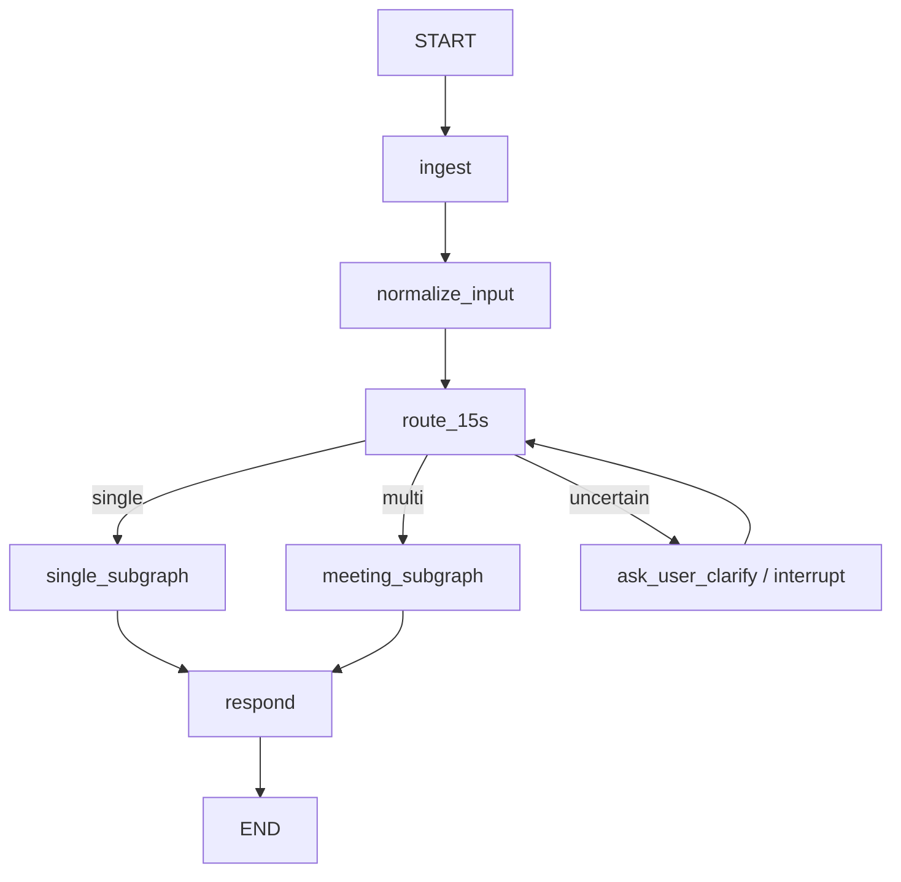
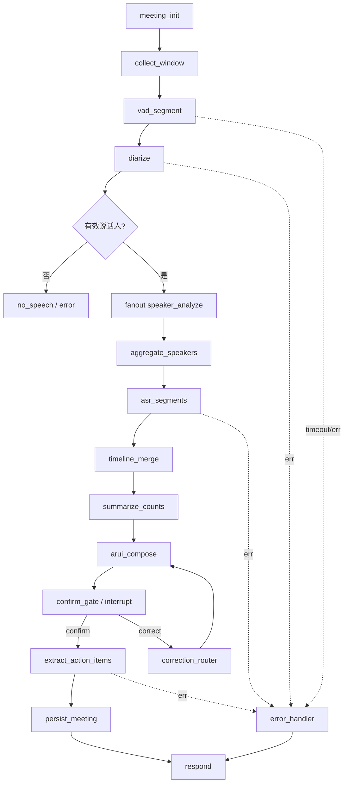

# LangGraph 多人识别节点设计（赛事重构版）

> 目标：按 JUNCTION CHINA 2026 智能穿戴赛道标准重构；单人节点沿用现有思路，本文重点设计**多人节点、唯一分叉、兜底试错、ARUI 五状态、虚拟键盘、数据库与证据链**。
> 本轮只设计，不改代码、不提交。

## 0. 前提与场景

- **场景**：AR 会议行动项助手。多人识别负责“谁在说”；行动项抽取负责“说了什么、谁负责、何时截止”；ARUI 在眼镜上低干扰呈现。
- **唯一分叉**：第一次 15 秒切片判定“单人 / 多人”。单人走既有子图；多人进入多人识别窗口（本文子图）。
- **输入**：语音（现有） + 文本（新增；模拟器虚拟键盘 + AI 推荐按钮 + 宿主 `takeTextInput`）。
- **本地模型/规则**：降级为 fallback，不作为主链路；主链路 LangGraph + 远端/本地模型可切换。
- **数据库**：复用 `data/people.json` / 照片；会议相关新增 SQLite 表；保留 JSON 文件作为无 DB 兜底。

## 1. 总体架构

```text
AR 眼镜 / 模拟器
  ├─ FusionUI ARUI（五状态、会议窗口、虚拟键盘）
  ├─ 语音采集（input.audio）
  ├─ 文本输入（虚拟键盘 / 宿主 takeTextInput）
  └─ 事件流（SSE/WebSocket 或轮询）
        │
        ▼
Agent Gateway（FastAPI/现有 stdlib 均可）
  ├─ 鉴权 / 限流 / 请求幂等（request_id）
  ├─ LangGraph 运行时（checkpointer = SQLite）
  └─ 事件转换 → ARUI view model
        │
        ▼
LangGraph
  ├─ 顶层：ingest → normalize → route_15s（唯一分叉）
  ├─ single_subgraph（既有思路）
  └─ meeting_subgraph（本文重点）
        ├─ VAD/分段/聚类/声纹/ASR/行动项/ARUI
        └─ 工具：people_db、asr、llm、metrics、fallback
        │
        ▼
数据层
  ├─ people.json / photos（复用）
  ├─ meetings.db（SQLite：meeting/slice/speaker/segment/action/command/arui_event/error/latency）
  └─ data/meetings/<id>/audio/*.wav（原始音频）
```

## 2. 顶层图：唯一分叉



- 顶层只有 `route_15s` 一个条件边；确认、纠错、重试都在子图内部，不新增用户可见分叉。
- `route_15s` 的判定结果写入 `state.route`，之后不再自动改；用户说“这是会议/这是单人”属于**纠正**，通过 `Command(goto=...)` 重入对应子图，并保留已录的 15 秒音频。
- 所有节点共享 `thread_id = meeting_id`，`request_id` 单调递增；旧请求结果不覆盖新结果。

### 2.1 AgentState（LangGraph 状态）

```python
class AgentState(TypedDict, total=False):
    # 会话/请求
    request_id: int
    meeting_id: str
    source: Literal["voice", "text"]
    raw_text: str
    audio_ref: str | None
    context: dict            # 上一次 ARUI、选中项、会议范围
    # 分流
    route: Literal["single", "multi", "unknown"]
    route_confidence: float
    route_features: dict
    # 生命周期
    stage: Literal["standby", "processing", "pending_confirm", "done", "error"]
    # 多人
    slice_seq: int
    speakers: list[dict]
    segments: list[dict]
    summary: dict            # 只放计数，不放身份
    details_ready: bool
    action_items: list[dict]
    # ARUI
    view: Literal["FULL", "FOCUS", "COMPACT"]
    focus: dict
    pending_confirmation: bool
    # 质量/证据
    errors: list[dict]
    stale: bool
    latency_ms: dict
```

## 3. 第一次 15 秒分流器（关键节点）

### 3.1 目标

用 15 秒音频判断：

- 单人：一个人持续说，用于单人识别/对话；
- 多人：≥2 个稳定说话人、有轮流/重叠；
- 不确定：证据不足，扩展窗口或问用户。

### 3.2 特征（不调用 LLM，纯音频/轻量模型）

| 特征 | 说明 | 多人倾向 |
|---|---|---|
| 稳定说话人数 `n_spk` | 分段 + 声纹聚类，持续 ≥2s 的簇才计数 | ≥2 |
| 轮次 `turns` | 说话人切换次数 | ≥1 |
| 重叠比例 `overlap_ratio` | 重叠时长 / 语音时长 | 高 |
| 最长单人连续段 `max_run` | 一个人连续说多久 | 短（<10s） |
| 语音占比 `speech_ratio` | VAD 语音 / 15s | 中高 |
| 簇间距离 `cluster_gap` | 声纹簇间余弦差 | 明显 |

### 3.3 判定规则

```text
if n_spk >= 2 and 各自 >= 2s and turns >= 1:
    multi, confidence = 0.8 + min(0.15, (n_spk-2)*0.05)
elif n_spk == 1 and speech_ratio >= 0.6 and max_run >= 12s:
    single, confidence = 0.8
elif n_spk == 1 and turns == 0 and speech_ratio < 0.3:
    uncertain
else:
    uncertain
```

### 3.4 不确定时的兜底（必须实现）

1. **扩展窗口**：再录 15 秒（总 30 秒）重算；仍不确定 → 2。
2. **用户澄清**：ARUI 显示“这是会议还是单人？”，虚拟键盘/语音选择；`interrupt` 等待。
3. **默认策略**：赛事现场默认 **多人**（会议场景更常见，且单人子图可随时纠正）；记录 `route=multi, confidence<0.5`，ARUI 标注“按单人模式纠正”。
4. **纠正**：用户说“这是单人” → `Command(goto="single_subgraph")`，已录 15 秒作为单人输入。

> 15 秒对“一个人先讲、其他人后加入”的会议可能误判为单人；所以 3.4 的扩展/澄清是必须的，不要一次判死。

## 4. 单人子图（接口，沿用既有思路）

- 输入：15 秒音频 / 文本；
- 节点：`identify`（声纹/人脸）→ `profile` → `card_compose` → `respond`；
- 输出：`stage=done`、`view=FULL`、`speaker/identity`；
- 与多人子图共享 `people_db`、`ARUI renderer`、`request_id`。

本文不展开单人节点；只保证接口：

```text
single_subgraph(state) -> state(speakers=[one], view=FULL, stage=done)
```

## 5. 多人子图（重点）

### 5.1 图



### 5.2 节点契约

| 节点 | 输入 | 输出 | 工具/模型 | 超时/重试 | 兜底 | ARUI 状态 |
|---|---|---|---|---|---|---|
| `meeting_init` | `meeting_id`, 15s 音频 | meeting 行、slice 0 | SQLite | — | JSON 文件 | 处理中 |
| `collect_window` | 15s / 滚动窗口 | PCM 分片、时间轴 | input.audio 会话链 | 60s/session | 本地缓存 | 处理中 |
| `vad_segment` | PCM | 语音段、重叠标记 | pyannote / 能量 VAD | 2s, 1 retry | 能量 VAD | 处理中 |
| `diarize` | 语音段 | 簇 `spk_0..n` | CAM++ + 聚类 | 5s, 1 retry | 单簇 | 处理中 |
| `speaker_analyze`（Send 并行） | 每个 spk 合并音频 | `person_id/name/sim/seconds` | CAM++ + people_db | 2s/spk, 1 retry | 未知 | 处理中 |
| `aggregate_speakers` | 并行结果 | speakers、去重 | — | — | 保留最大 sim | 处理中 |
| `asr_segments`（并行） | 每段音频 | text/confidence | paraformer / OpenAI ASR | 5s/段, 1 retry | 空文本 | 处理中 |
| `timeline_merge` | 多窗口结果 | 全局 timeline | — | — | 按时间拼接 | 处理中 |
| `summarize_counts` | speakers | `{n, known, unknown, overlap}` | — | — | — | 待确认 |
| `arui_compose` | summary/details/action | view model | 规则 + 模板 | — | 最小文本 | 待确认 |
| `confirm_gate` | view model | `interrupt` | LangGraph interrupt | 用户确认 | 超时 → 待确认 | 待确认 |
| `extract_action_items` | transcript | `{owner,task,deadline,status}` | LLM + 规则 | 8s, 2 retry | 规则抽取 | 完成 |
| `persist_meeting` | 全部 | DB 事务 | SQLite | 2s, 2 retry | JSON | 完成 |
| `correction_router` | 用户纠正 | 局部重跑 | Command/time travel | — | 保留旧值 | 处理中 |
| `error_handler` | 异常 | 分类/提示/重试 | — | — | 降级 | 异常 |

### 5.3 并行与去重

- `speaker_analyze` 用 `Send` 按 spk 并行；每个 spk **只做一次** 1:N 检索（符合“同一说话人多次出现只查一次”）。
- `asr_segments` 按段并行；单段失败不影响其他段。
- `aggregate_speakers` 以 `spk_id` 去重；同一人跨窗口用声纹缓存合并，避免重复检索。
- 所有节点幂等：`idempotency_key = meeting_id + slice_seq + node_name`。

### 5.4 摘要 / 详情分离

- `summarize_counts` 只输出：人数、熟人/陌生人计数、重叠丢弃数；**不输出姓名**。
- 详情只在用户二次确认后由 `GET /slice/{seq}` 返回；后端已算好，存 `details_ready=true`。
- 陌生人建库：详情页进入 `MEET_ENROLL` 嵌套状态，复用单人建库；保存后回详情。

### 5.5 跨切片/上下文

- 每个 slice 独立 `seq`，但共享 `meeting_id`、speaker embedding cache、people_db。
- 相邻 slice 的同一人：优先用缓存 embedding 匹配，减少重复 1:N；仍保留独立 slice 记录。
- 旧 slice 的 action items 不覆盖新 slice；按 `created_at/seq` 合并，冲突时以最新确认为准。

## 6. ARUI：五状态 + 两次调整 + 多模态

### 6.1 五状态（同一页面不同呈现）

| 状态 | 标题 | 内容 | 可执行动作 |
|---|---|---|---|
| 待命 | `会议助手` | “说『整理会议待办』或输入指令” | 语音/键盘/AI 推荐 |
| 处理中 | `正在整理…` | 当前阶段（分段/分人/转写/抽取） | 取消 |
| 待确认 | `找到 N 项` | 行动项列表 + “N 项待确认” | 确认保存 / 纠正 |
| 完成 | `已保存/已更新` | 最新列表 + 时间 | 继续指令 |
| 异常 | `出错了` | 具体原因（超时/模型/网络）+ 是否注入测试 | 重试 |

### 6.2 三套布局（满足“两次连续调整”）

| 布局 | 字段 | 触发 |
|---|---|---|
| `FULL` | 负责人 + 事项 + 截止 + 状态 | 首次生成 |
| `FOCUS` | 待确认优先、加粗、置顶 | “只看待确认/把待确认放前面” |
| `COMPACT` | 只留负责人 + 截止 | “只保留负责人和截止时间” |

- 第一次调整：内容筛选/排序（FOCUS）。
- 第二次调整：字段/行高/布局（COMPACT）。
- 两次都通过同一个 `arui_compose` 节点，**不是切页面/切图**。

### 6.3 多模态与纠正

- 语音、文本走同一 `ingest → normalize`；`source` 只影响输入方式，不影响后续节点。
- 文本来源：
  1. 模拟器宿主 `takeTextInput()`（`input.text`，Host 2）；
  2. 眼镜虚拟键盘；
  3. AI 推荐按钮（直接发送完整指令）。
- 纠正：`correction_router` 解析 `{target, field, newValue}`，只改指定项，保留其余上下文；`interrupt` 恢复后重跑 `arui_compose`。
- 上下文：`state.context` 保存最近一次 `view/items/selected`；跨方式切换不清空。

## 7. 虚拟键盘 + AI 推荐按钮（模拟器）

### 7.1 触发与布局

- 待命/完成状态按「文本」进入；或语音说“打字”。
- 640×480 下半屏键盘，上半屏保留当前 ARUI 内容（低干扰）。
- 3×4 网格（每页 12 键）：字母/数字/退格/空格/翻页/发送；选中键高亮。

### 7.2 导航

| 动作 | 行为 |
|---|---|
| up/down/left/right | 移动焦点（网格） |
| activate | 输入当前键 / 执行功能键 |
| back | 关闭键盘（不丢失已输入） |

### 7.3 AI 推荐按钮

- 键盘上方固定 3 个推荐 chip，由当前 `state` 生成：
  - 会议待确认 → “只看待确认”
  - 已识别人物 → “王姐负责的排前面”
  - 布局 → “只留负责人和截止时间”
- `activate` 直接发送该完整指令；不经过逐字输入。
- 推荐由本地模板 + LLM 预生成；LLM 不可用时用静态模板（兜底）。

### 7.4 中文输入边界

- 虚拟键盘以英文/数字/拼音为主；中文优先用：
  1. 语音；
  2. AI 推荐/常用短语；
  3. 模拟器宿主 `takeTextInput` 注入 UTF-8（演示/测试）。
- 不承诺在眼镜上实现完整中文 IME；比赛中如实说明边界。

### 7.5 模拟器接口

- `input.text` 能力需在 `glasses/FusionUIApp.json` 声明。
- 宿主文本提交走 `takeTextInput()`；虚拟键盘走 FusionUI 控件 + 导航动作。
- 键盘状态不污染 `state.context`；发送后才进入 `ingest`。

## 8. 兜底 / 试错矩阵

| 故障 | 检测 | 第一次处理 | 第二次 | 用户可见 |
|---|---|---|---|---|
| ASR 超时/不可用 | 超时 5s / 异常 | 重试 1 次 | 空文本 + “转写不可用” | 异常/完成（降级） |
| LLM 超时/不可用 | 8s / 5xx | 重试 2 次（退避） | 规则抽取 | 完成（标注规则兜底） |
| 分段/聚类失败 | 异常/空 | 能量 VAD | 单说话人 | 完成（标注降级） |
| 声纹库不可用 | DB 异常 | 内存缓存 | 全部标陌生人 | 完成（标注） |
| 数据库写失败 | 异常 | 重试 2 次 | JSON 落盘 | 完成（待同步） |
| 渲染失败 | 异常 | 最小文本布局 | 纯文本 | 异常（可重试） |
| 网络断 | 连接异常 | 本地缓存 | 恢复后补传 | 异常/处理中 |
| 旧响应 | request_id 过期 | 丢弃 | 标记 stale | 不覆盖新结果 |
| 模型输出坏 JSON | 校验失败 | 重试 1 次 | 规则模板 | 完成（标注） |

**重试策略**：指数退避 200ms/500ms/1s；熔断 3 次失败后 30s 内直接降级；所有错误写 `errors` 表和日志。

## 9. 数据库设计

### 9.1 复用

- `data/people.json`：人物、声纹、照片（保持现有 CRUD）。
- `data/meetings/<id>/audio/*.wav`：原始音频。
- `data/meetings/<id>/meta.json`：无 SQLite 时的兜底完整记录。

### 9.2 SQLite（建议）

```sql
meetings(id TEXT PK, title TEXT, status TEXT, route TEXT,
         started_at TEXT, ended_at TEXT, audio_path TEXT, created_at TEXT);
slices(id TEXT PK, meeting_id TEXT, seq INTEGER, start_s REAL, end_s REAL,
       status TEXT, dropped_overlap INTEGER);
speakers(id TEXT PK, slice_id TEXT, spk_label TEXT, person_id TEXT,
         similarity REAL, seconds REAL, embedding_ref TEXT);
segments(id TEXT PK, slice_id TEXT, spk_label TEXT, start_s REAL, end_s REAL,
         text TEXT, confidence REAL);
action_items(id TEXT PK, meeting_id TEXT, seq INTEGER, owner_person_id TEXT,
             owner_label TEXT, task TEXT, deadline TEXT, status TEXT,
             confirmed INTEGER, source_slice INTEGER);
commands(id TEXT PK, meeting_id TEXT, request_id INTEGER, source TEXT,
         text TEXT, intent TEXT, created_at TEXT);
arui_events(id TEXT PK, meeting_id TEXT, request_id INTEGER, stage TEXT,
            view TEXT, payload_json TEXT, latency_ms REAL);
errors(id TEXT PK, meeting_id TEXT, request_id INTEGER, node TEXT,
       code TEXT, detail TEXT, injected INTEGER, created_at TEXT);
latency(id TEXT PK, meeting_id TEXT, request_id INTEGER, node TEXT,
        ms REAL, created_at TEXT);
```

- `people` 不迁库，避免破坏现有控制台/声纹接口；跨库用 `person_id` 关联。
- 迁移：启动时若 `data/meetings/*/meta.json` 存在且 DB 为空，导入一次；之后双写保留一个版本周期。
- 本地 fallback：无 SQLite 时写 JSON，字段与表一致。

## 10. API / 事件协议

| 方法 | 路径 | 说明 |
|---|---|---|
| POST | `/api/v2/agent/command` | 统一语音/文本命令；`{requestId, meetingId, source, text, context}` |
| GET | `/api/v2/agent/stream/{meetingId}` | SSE：`stage/speakers/summary/arui/error/latency` |
| POST | `/api/v2/session/{id}/slice` | 提交 15s/滚动切片（时间区间） |
| GET | `/api/v2/session/{id}/slice/{seq}` | 详情（二次确认后） |
| POST | `/api/v2/session/{id}/archive` | 归档 |
| GET | `/api/v2/session/{id}/timeline` | 会议时间轴 |
| POST | `/api/v2/session/{id}/correct` | 纠正（owner/time/layout） |
| GET | `/api/v2/metrics/latency` | 10 次延迟测量结果 |

事件示例：

```json
{"type":"stage","stage":"processing","node":"diarize","requestId":7}
{"type":"summary","requestId":7,"speakerCount":4,"known":2,"unknown":2}
{"type":"arui","requestId":7,"view":"FULL","items":[...],"pendingConfirm":3}
{"type":"error","requestId":7,"code":"LLM_TIMEOUT","retryable":true,"injected":true}
```

## 11. 与赛事评分对照（设计如何拿分）

| 评分点 | 设计对应 |
|---|---|
| ARUI 25 | 五状态、FULL/FOCUS/COMPACT、低干扰键盘、确认后显示敏感信息 |
| 自动化 25 | 意图→行动项抽取→筛选/排序/纠正→确认写库；工具调用与失败处理 |
| 多模态 20 | 语音/文本同一入口；虚拟键盘+宿主文本；切换与独立纠正；上下文 |
| 实时 10 | 节点级 SSE、request_id 旧结果作废、延迟表、超时/熔断 |
| 场景 10 | 会议行动项，解决“会后失忆”；声纹提供“谁说的” |
| 交付 10 | 8 用例、10 次延迟、PDF/视频、冻结包（含依赖锁定） |

## 12. 八项验收用例（设计态）

| # | 用例 | 走哪些节点 | 预期 |
|---|---|---|---|
| 1 | 语音“整理会议待办” | ingest→route→meeting→action→arui | 五状态走完，生成列表 |
| 2 | “只看待确认” | command→arui(FOCUS) | 内容减少 |
| 3 | “只留负责人和截止” | command→arui(COMPACT) | 布局/字段变化 |
| 4 | 语音开始+文本追加 | ingest(source 切换)→context | 上下文保留 |
| 5 | “第2条负责人改里奥” | correction→arui | 仅第2条变化 |
| 6 | “保存吗？” | confirm interrupt | 未确认不写库 |
| 7 | 注入 LLM 超时 | error→fallback | 异常+重试，不显示旧结果 |
| 8 | 快速两条指令 | request_id/stale | 旧响应作废 |

延迟：命令提交→首个 stage→ARUI 完成；至少 10 次，输出 p50/p95、失败率、注入测试标记。

## 13. 重构目录建议

```text
src/
  agent/
    graph.py            # StateGraph 组装
    state.py            # AgentState
    routers.py          # route_15s / correction
    nodes/
      ingest.py
      meeting.py        # init/collect/vad/diarize/summary
      speakers.py       # fan-out 声纹
      asr.py
      action_items.py
      arui.py
      confirm.py
      persist.py
      errors.py
    tools/
      people.py
      llm.py
      metrics.py
    fallback/
      rules.py
  db.py                 # SQLite
  server.py             # 薄网关
glasses/src/
  app.js                # 状态机
  views/meeting.js
  views/keyboard.js
  net.js
```

阶段：

1. 先搭 `route→meeting→summary→ARUI` 最小闭环（可 stub）；
2. 接声纹/ASR/行动项；
3. 加纠正/确认/异常/旧结果；
4. 虚拟键盘与 AI 推荐；
5. 8 用例 + 延迟 + 冻结包。

## 14. 开放决策

| 编号 | 决策 | 建议 |
|---|---|---|
| D1 | 15s 不确定默认多人还是单人 | 多人（会议场景），可纠正 |
| D2 | 数据库 SQLite 还是 JSON | SQLite；JSON 仅兜底 |
| D3 | 虚拟键盘中文 | 语音/推荐为主，键盘英文/拼音；如实说明 |
| D4 | LLM 供应商 | DeepSeek/MiMo 可切换；规则兜底 |
| D5 | 依赖锁定 | 比赛冻结包必须做（与之前 P1-03 冲突，需解禁） |
