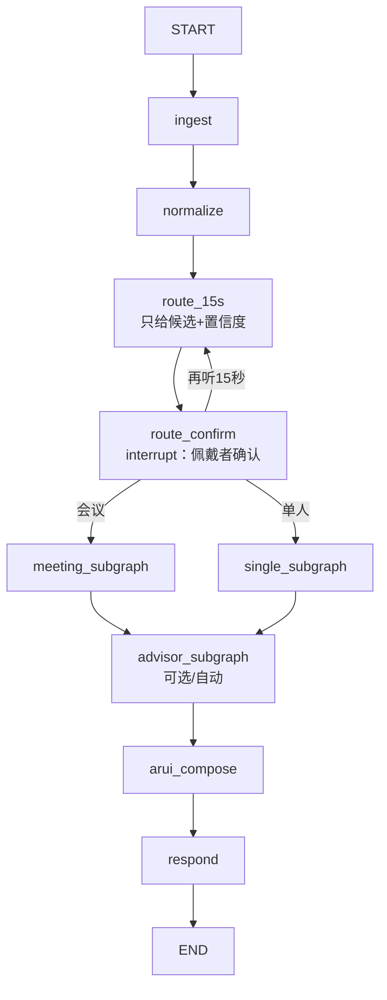
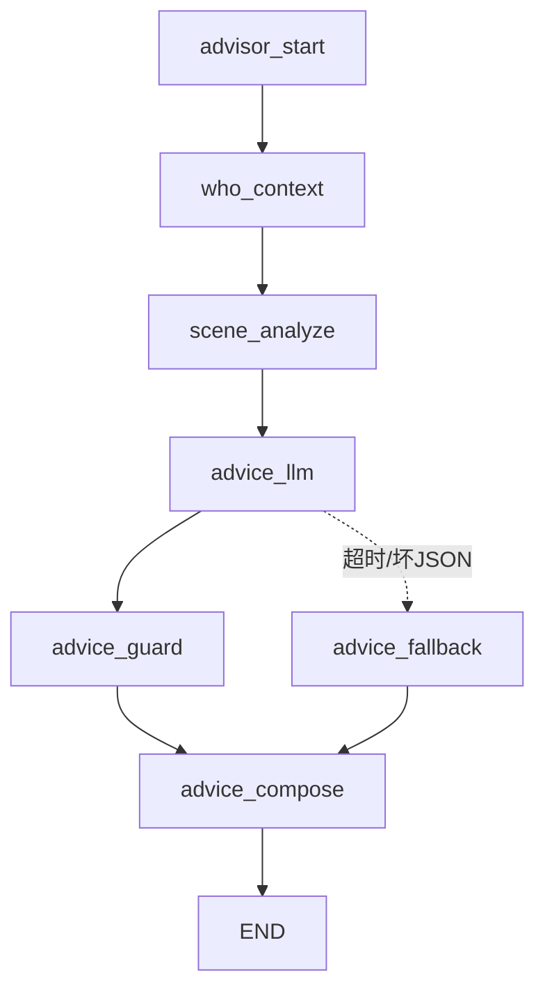

# 简化版 LangGraph 设计 v2（按 D1–D5 + 对话建议智能体）

> 本文覆盖/修订 [13-LangGraph多人节点设计](13-LangGraph多人节点设计.md) 中的 D1–D5。
> 原则：**先跑通逻辑，不搞复杂**；JSON 先行，SQLite 留接口；虚拟键盘只做短语键盘；对话建议用 LangGraph 智能体。
> 本轮只设计，不改代码、不提交。

## 0. 决策摘要

| 编号 | 你的决定 | 设计调整 |
|---|---|---|
| D1 | 15 秒后由**佩戴者主动确认** | 新增 `route_confirm` 中断：推荐“会议/单人/再听 15 秒”，确认后才进子图 |
| D2 | 先用 **JSON**，逻辑跑通再换 | 定义 `MeetingRepo` 接口；`JsonMeetingRepo` 实现；SQLite 以后替换 |
| D3 | **虚拟短语键盘**（给几个提示语） | 不做全键盘/中文 IME；2 页短语 + 3 个 AI 推荐 chip |
| D4 | 模型供应商保留接口 | `LLMProvider` 抽象；DeepSeek/MiMo/规则模板可切换 |
| D5 | 依赖锁定先不管 | 冻结包阶段再补 |

## 1. 修订后的顶层图



- 顶层仍然只有 `route_15s` 一个“自动分叉”；
- `route_confirm` 是**人确认**，不是系统自动分叉；它同时承担赛事要求的“待确认”状态；
- 佩戴者确认后，15 秒音频作为第一段输入，不浪费。

### 1.1 `route_confirm` 的 ARUI

```text
[识别到 2–3 个声音]
建议：会议模式（置信度 0.82）

[ 会议 ]   [ 单人 ]   [ 再听 15 秒 ]
```

- 即使置信度高，也**必须佩戴者确认**（D1）；
- 选“再听 15 秒”追加音频重算；
- 选错后可随时说/点“这是单人/这是会议”纠正，用 `Command(goto=...)` 重入。

## 2. 多人子图（简化版）

```text
meeting_init
 → collect_window（15s + 滚动）
 → vad_segment
 → diarize
 → speaker_analyze（按 spk 并行，整段音色只查一次）
 → asr_segments（逐段并行）
 → timeline_merge
 → summary（只给人数/熟人/陌生人/重叠数）
 → arui_meeting（会议窗口）
 → confirm（详情/保存/建议）
 → action_items（LLM+规则）
 → persist（JSON）
```

保留上一版的关键点：

- 摘要不露身份，详情二次确认；
- 同 spk 一个切片只做一次 1:N；
- 旧响应按 `request_id` 作废；
- 失败降级（VAD/单说话人/空文本/规则抽取）。

**不做的**（避免复杂）：

- 不做逐帧流式 diarization；
- 不做重叠语音拆分（默认丢弃）；
- 不做中文虚拟全键盘；
- 不做音频情绪识别（“态度”是语言建议，不是读心）。

## 3. 新增：对话建议子图（advisor）

这正是你说的“智能体自动分析谁、问什么、什么态度、怎么回答”。

### 3.1 触发

- **单人模式**：识别出是谁后自动生成（可关闭）；
- **多人模式**：
  - 默认不刷屏；
  - 佩戴者点“给我建议”/说“我该怎么接”时，对**当前/选中说话人**生成；
  - 某个 slice 结束后，可对“最近说话人”预生成 1 份，缓存不展示。

### 3.2 图



| 节点 | 作用 | 输入 | 输出 | 兜底 |
|---|---|---|---|---|
| `who_context` | 确认“这是谁” | person_id、声纹/人脸、最近互动、承诺 | `who{name,role,relation,last_met,commitments}` | 只给“陌生人” |
| `scene_analyze` | 判断场景/话题/态度 | 最近对话、会议/单人、用户目标 | `scene{mode,topic,mood,risk}` | 默认“中性/谨慎” |
| `advice_llm` | 生成问题/回答/态度 | who + scene + 原话 | 结构化 JSON | 模板 |
| `advice_guard` | 隐私/置信度过滤 | 建议 | 去掉敏感/低置信 | 只留通用问题 |
| `advice_compose` | 变成短语 chip | 建议 | 3 问题 + 2 回答 + 1 态度 | 静态短语 |

### 3.3 结构化输出（LLM 必须按这个 schema）

```json
{
  "who": {
    "person_id": "p_x",
    "name": "王姐",
    "relation": "前同事/产品经理",
    "last_met": "3 天前",
    "commitments": ["答应下周给报价单"]
  },
  "scene": {
    "mode": "meeting",
    "topic": "项目报价",
    "mood": "neutral",
    "risk": ["截止时间", "预算"]
  },
  "attitude": {
    "recommended": "warm_direct",
    "why": "前同事、有未兑现承诺，先寒暄再问进度",
    "avoid": ["当众催承诺", "过度正式"]
  },
  "questions": [
    {"text": "报价单这周能定吗？", "why": "兑现承诺", "tone": "warm_direct"},
    {"text": "预算卡在哪一步？", "why": "定位风险", "tone": "direct"},
    {"text": "需要我提供什么材料？", "why": "推进", "tone": "supportive"}
  ],
  "replies": [
    {"trigger": "如果他说还在等审批", "text": "那我先把材料补齐，周四再对一次？", "tone": "supportive"},
    {"trigger": "如果他说预算砍了", "text": "我们先保哪一块？", "tone": "direct"}
  ],
  "confidence": 0.84
}
```

### 3.4 “谁 / 问什么 / 什么态度 / 怎么回答”怎么算

| 维度 | 依据 | 失败时 |
|---|---|---|
| **谁** | 声纹 1:N（0.72+margin 0.08）+ 人物库最近互动/承诺 | 显示“陌生人”，建议通用寒暄 |
| **问什么** | 未兑现承诺、上次话题、当前会议行动项、对方角色 | 模板：进度/困难/下一步 |
| **什么态度** | 关系（上级/客户/朋友/前任同事）+ 场景（会议/1:1）+ 风险词 | 默认“礼貌直接” |
| **怎么回答** | 对方最近一句 + 人物库历史 + 用户目标 | 模板：确认+给方案+问下一步 |

> 不声称“识别情绪”；`mood` 只是从文本推断的语气，ARUI 上标“建议”，不标“事实”。

### 3.5 ARUI 呈现

```text
王姐 · 前同事 · 3 天前见过
建议态度：先寒暄，再问进度（别当众催）

[问] 报价单这周能定吗？
[问] 预算卡在哪一步？
[问] 需要我提供什么材料？

[答] 如果还在审批：我先把材料补齐…
[换一批] [更委婉] [更直接]
```

- 一次最多 3 个问题 + 2 个回答，避免干扰；
- “换一批/更委婉/更直接”是**连续调整**，可算赛事的内容/重点变化；
- 敏感承诺默认折叠，确认后展开。

## 4. 虚拟短语键盘（D3）

不做全键盘，做 **2 页短语 + 3 个 AI 推荐**。

### 4.1 触发

- 待命/完成/建议页按「文本」进入；
- 键盘占下半屏，上半屏保留当前 ARUI；
- 上下左右移动焦点，确认发送，返回关闭。

### 4.2 短语页

**第 1 页 · 会议/行动项**

| 短语 | 作用 |
|---|---|
| 只看待确认 | FOCUS |
| 按负责人分组 | 重排 |
| 只留负责人和截止 | COMPACT |
| 保存 | 确认写库 |
| 给我建议 | 触发 advisor |
| 换个说法 | 重新生成建议 |

**第 2 页 · 对话建议**

| 短语 | 作用 |
|---|---|
| 问他项目进度 | 生成问题 |
| 他上次答应什么 | 查承诺 |
| 再委婉一点 | 调整态度 |
| 直接一点 | 调整态度 |
| 这条不对 | 纠正 |
| 重新分析 | 重跑 advisor |

### 4.3 AI 推荐 chip

- 键盘上方固定 3 个，由当前 `who/scene` 生成：
  - “问他报价单”
  - “先寒暄再问进度”
  - “只留待确认事项”
- 点 chip 直接发送完整指令，不逐字输入。

### 4.4 自由文本

- 模拟器宿主 `takeTextInput()` 仍保留（`input.text`，Host 2），用于输入任意中文；
- 短语键盘解决“只有眼镜导航键”的场景；
- 如实说明：眼镜端不做完整中文 IME。

## 5. JSON 数据设计（D2）

### 5.1 仓库接口

```python
class MeetingRepo:
    def create(self, meeting_id, title) -> dict: ...
    def get(self, meeting_id) -> dict: ...
    def add_slice(self, meeting_id, slice) -> dict: ...
    def save_advice(self, meeting_id, advice) -> dict: ...
    def archive(self, meeting_id) -> dict: ...
    def list(self) -> list[dict]: ...

class JsonMeetingRepo(MeetingRepo):   # 现在
    ...
class SqliteMeetingRepo(MeetingRepo): # 以后
    ...
```

### 5.2 `data/meetings/<id>/meta.json`

```json
{
  "meeting_id": "m_xxx",
  "title": "周会",
  "status": "recording|pending_confirm|done|error",
  "route": "meeting|single",
  "route_confidence": 0.82,
  "route_confirmed_by": "wearer",
  "started_at": "2026-11-07 18:00:00",
  "ended_at": null,
  "audio": "audio/meeting.wav",
  "slices": [
    {
      "seq": 1, "start": 0.0, "end": 15.0,
      "speakers": [
        {"spk": "spk_0", "person_id": "p_x", "name": "王姐",
         "similarity": 0.93, "seconds": 8.2}
      ],
      "summary": {"n": 2, "known": 1, "unknown": 1, "overlap": 0},
      "segments": [
        {"spk": "spk_0", "start": 0.2, "end": 4.1, "text": "..."}
      ]
    }
  ],
  "action_items": [
    {"seq": 1, "owner": "王姐", "task": "给报价单",
     "deadline": "周五", "status": "pending", "confirmed": false}
  ],
  "advice": [
    {
      "request_id": 7,
      "person_id": "p_x",
      "attitude": {"recommended": "warm_direct", "avoid": ["当众催"]},
      "questions": [{"text": "报价单这周能定吗？", "tone": "warm_direct"}],
      "replies": [{"trigger": "还在审批", "text": "我先把材料补齐…"}],
      "confidence": 0.84
    }
  ],
  "commands": [{"request_id": 7, "source": "text", "text": "给我建议"}],
  "errors": [],
  "latency": []
}
```

- 先写 JSON，接口不变；以后 `SqliteMeetingRepo` 直接替换。
- 原 `data/people.json` 继续复用，`person_id` 关联。
- 原始音频仍 `data/meetings/<id>/audio/`。

## 6. 兜底/试错（简化版）

| 故障 | 处理 |
|---|---|
| 15 秒无法判定 | `route_confirm` 让佩戴者选；可选“再听 15 秒” |
| 声纹模型不可用 | 全部标“陌生人”，建议通用寒暄 |
| ASR 不可用 | 显示“转写不可用”，仍可给建议/行动项（文本输入） |
| LLM 超时/坏 JSON | 模板建议：进度/困难/下一步；态度默认礼貌直接 |
| 说话人聚类失败 | 单说话人 + 标注“未分人” |
| JSON 写失败 | 内存缓存 + 重试；提示“待保存” |
| 旧响应 | `request_id` 丢弃；不覆盖新建议 |
| 用户纠正 | 改 person/tone/detail，局部重跑 advisor，不清空上下文 |

## 7. 与评分对照（保留分数）

| 评分 | 对应 |
|---|---|
| ARUI 25 | 五状态 + 建议卡 + 短语键盘 + 低干扰 |
| 自动化 25 | 谁/问什么/态度/回答 + 行动项 + 确认写库 |
| 多模态 20 | 语音/短语/宿主文本同一入口；切换与纠正 |
| 实时 10 | request_id、延迟记录、超时降级 |
| 场景 10 | 会议行动项 + 对话建议 |
| 交付 10 | JSON 复现、8 用例、10 次延迟、PDF/视频 |

## 8. MVP 范围（避免复杂）

**做**

- 15 秒候选 + 佩戴者确认；
- 会议：分人、摘要/详情、行动项、确认保存；
- 单人：识别 + 对话建议；
- 短语键盘 + 3 个 AI 推荐；
- JSON 存储；
- 五状态、旧结果作废、异常降级。

**不做（以后）**

- SQLite（接口保留）；
- 中文全键盘/IME；
- 实时流式 diarization；
- 云端厂商 ASR 适配；
- 依赖锁定（冻结包阶段再补）；
- 音频情绪识别。

## 9. 待确认

1. 单人也默认“自动生成对话建议”，还是按“给我建议”才生成？（建议默认生成 1 次，避免刷屏）
2. 会议建议是对“当前说话人”还是“选中的人”？（建议默认当前说话人，可切换）
3. 短语键盘的 6+6 条是否够？你可以在实现前直接换词。
