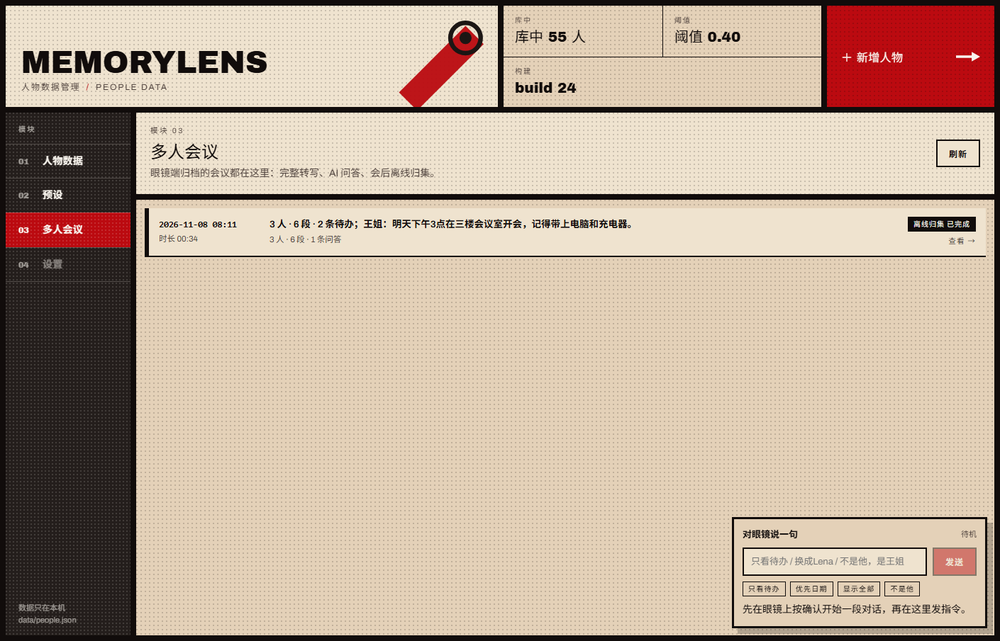
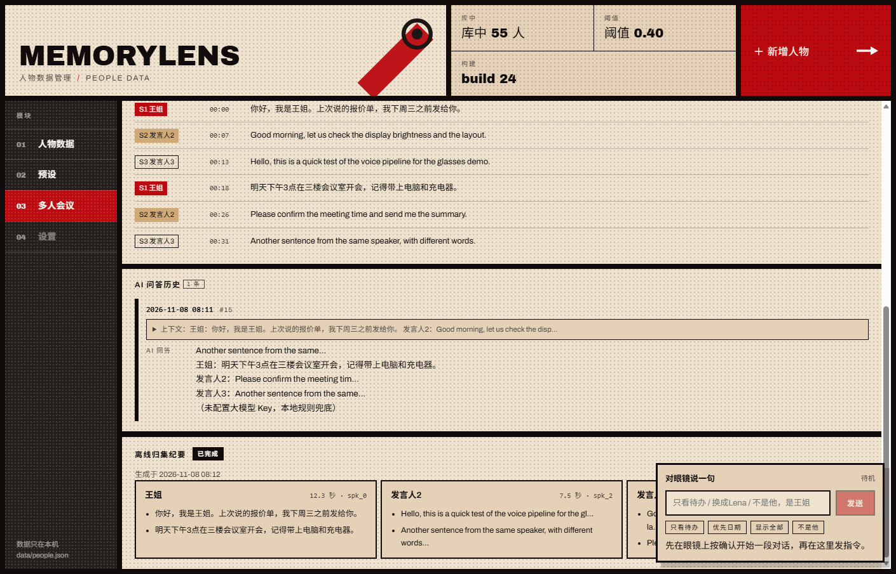

# 多人会议模块（PRD 版）实现与验收

> ⚠️ **已废弃**：PRD V1.0 与工作区 `docs/19`、`docs/20` 及实际代码不一致。
> 会议模式以 **[docs/27-会议模式可行方案.md](27-会议模式可行方案.md)** 为准；
> 本文仅保留作 PRD 差异记录，不再作为验收依据。

> 对应 PRD：AR 眼镜会议智能助手 · 多人模块 V1.0。
> 本版本在现有 MemoryLens（Python 后端 + FusionUI 眼镜端 + 原生 JS 控制台）上落地，
> **单人模块与交互完全不动**；多人模块的按键语义、实时字幕、AI 浮窗、会后留存按 PRD 重做。

## 0. 一句话验收

眼镜端选「多人」→ 确认开始/停止录制 → 底部实时字幕按说话人分段 → 左键弹 AI 要点浮窗
→ 上下滚动 / 右键关闭 → 返回退出。会议结束后控制台「03 多人会议」能看到整场转写、
AI 问答历史、原始音频路径与离线归集结果。**没有 API Key 也能跑**（AI 问答降级为本地规则）。

## 1. 交互（与 PRD 2.2 对齐）

| 按键 | 多人模块内 | 实现位置 |
|---|---|---|
| 确认 | 未录制 → 开始录制；录制中 → 停止并持久化 | `glasses/src/index.js: navMeeting / startMeetingRecording / stopMeetingRecording` |
| 左 | 向后端要 AI 回答；无浮窗时打开，有浮窗时刷新 | `askMeeting / setMeetingPopup` |
| 右 | 浮窗开启时关闭；无浮窗无动作 | `closeMeetingPopup` |
| 上 / 下 | 浮窗开启时滚动文本；关闭时不做动作 | `scrollMeetingPopup` |
| 返回 | 停止录制（若在录）→ 关浮窗 → 清 UI 临时状态 → 回模式选择页 | `exitMeeting` |

- 浮窗无自动关闭；只有右键 / 返回键能关。
- 右上角常驻「● 录制中 mm:ss / ○ 未录制」；底部常驻 3 行字幕（S1/S2…）。
- 会议中每 6 秒首片、之后 8 秒切一片送转写（可用 `MEMORYLENS_MEETING_FIRST_SLICE_MS`
  / `MEMORYLENS_MEETING_SLICE_MS` 调）；比实时流式慢，但受平台"单条语音会话 60 秒"限制，
  这是在本项目现有语音接口下能做到的"准实时"。

## 2. 后端（薄调度层）

新增：

- `src/meeting_db.py`：SQLite 持久化（PRD 5.1 三张表 + 离线归集结果表）
- `src/meeting_service.py`：会话生命周期、音频留存、环形上下文、AI 问答、离线归集
- `src/server.py`：新增 `/api/meeting/*` 与 `/api/meetings*` 路由

为什么不是 SpringBoot + H2：本项目后端是零依赖的 Python 标准库 HTTP 服务，
现场部署成本最低。SQLite 与 H2 一样是内嵌库，表结构/SQL 语义可直接迁移 MySQL；
PRD 的"薄调度转发"职责（收音频、拼上下文、调第三方、落库）完全保留。

### 2.1 数据表（`data/meetings.db`）

```sql
meeting_session(session_id PK, meeting_id, mode='multi', is_recording,
                create_time, audio_file_path, finish_time,
                offline_diarization_status, duration_sec, speaker_count,
                segment_count, summary)
speech_record(id PK, session_id, spk_id, start_ts, end_ts, content, name)
ai_answer_record(id PK, session_id, context_snapshot, answer, create_time)
meeting_offline_summary(session_id PK, payload, updated_at)   -- 额外表，不污染 PRD 三表
```

- 时间戳统一毫秒（相对会议开始），`start_ts/end_ts`。
- 转写用唯一索引去重，同一 session 重复上传同一片不会翻倍。

### 2.2 音频留存

- 路径：`audio_storage/<session_id>.pcm`（16kHz / mono / s16le，PRD 5.2）。
- 每片 WAV 到达时先解出 PCM 追加写盘，再做分人/转写；停录后文件保留，供离线归集。

### 2.3 环形上下文与 AI 问答

- 内存里每个 session 一个 `deque(maxlen=12)`，只保留最近 N 条发言；服务重启后从
  `speech_record` 尾部恢复。可通过 `AR_MEETING_CONTEXT_N` 调整长度。
- 左键请求 `/api/meeting/ask`：取环形队列 → 拼 PRD 固定提示词 → 调大模型（`llm.answer_meeting`）
  → 返回要点式文本并写入 `ai_answer_record`。
- **没配 Key 时**：`llm.answer_meeting` 抛 `LLMUnavailable`，服务层用本地规则生成
  3–4 条要点（核心问题 / 最近发言 / 兜底说明），响应里 `degraded: true`，浮窗标「兜底」。
  补 Key 后自动升级，不改前端。

固定提示词（`src/llm.py: MEETING_QA_PROMPT`）：

```text
下面是一段线下会议对话，请完成以下要求：
1. 从对话中提取出核心问题；
2. 针对问题给出分点式的精简回答要点；
3. 语言简洁，避免长段落，适配小屏幕阅读。

对话上下文：
{context}
```

### 2.4 会后离线归集（可选加分）

`POST /api/meeting/offline`：状态 0 → 1，后台线程读完整 PCM → pyannote 分段 +
CAM++ 聚类 → 逐段转写 → 按说话人汇总 points；成功后状态 2，结果写
`meeting_offline_summary`。失败保留错误信息，状态回 0。演示音频约 10–20 秒完成。

### 2.5 API 一览

| 方法 | 路径 | 作用 |
|---|---|---|
| POST | `/api/meeting/start` | 建/恢复会话（进入模块时调用） |
| POST | `/api/meeting/feed` | 收一片音频/文本，返回 view + 字幕尾 + 发言人 |
| POST | `/api/meeting/ask` | 左键：环形上下文 → AI 回答 |
| POST | `/api/meeting/stop` | 停止录制、归档、结束 DB 会话 |
| POST | `/api/meeting/discard` | 进了模块没录内容时丢弃临时会话 |
| POST | `/api/meeting/offline` | 提交离线归集（异步） |
| GET | `/api/meeting/state?session=` | 眼镜端/调试查询当前会话 |
| GET | `/api/meetings` | 控制台会议列表 |
| GET | `/api/meetings/<session>` | 控制台会议详情（转写/问答/离线） |

## 3. 眼镜端 UI

- 新增控件：右上录制徽标、底部 3 行字幕（3 列 Text 拼一行）、AI 浮窗（5 行 × 4 列 Text）。
- **关键实现约束**：本模拟器运行时不允许在根 Board 下再挂第二个 Board（会报
  `IV-RT:1116 The display could not be updated`），因此浮窗没有用嵌套 Board：
  用一个带深色背景的空 Text 当底板，文字直接挂在根 Board 上，靠创建顺序叠放。
  视觉上是深色浮层（PRD 的"半透明"在单色绿镜片上的近似），完全由按键控制开闭。
- 排障开关：`MEMORYLENS_UI_POPUP=0` 可整体关闭浮窗，用于定位渲染问题。

## 4. 控制台（web/）

> 已合并远端最新 `777a2fe`（控制台去掉 02 对话分析页、模块重排）。
> 当前模块栏：**01 人物数据 / 02 预设 / 03 多人会议 / 04 设置（待开发）**；BUILD=22。

左侧 rail 新增 **03 多人会议**：

- 列表：创建时间、时长、说话人数、转写段数、AI 问答数、离线归集状态徽标、摘要；
  支持刷新、空态、错误提示。
- 详情：基础信息、完整转写（S1 王姐 + mm:ss）、AI 问答历史（上下文可折叠）、
  离线归集结果（按说话人分组的 points）；status 0 显示"生成离线归集纪要"按钮，
  3 秒轮询直到 2。

## 5. 一键启动模拟器

`sim.bat` → `tools/start-sim.ps1`：

1. 在 WSL 发行版里找 IrisView Developer Kit（优先 `IrisView`，兼容 Ubuntu）；
2. 检查 WSLg 与 Node 24；
3. 后端没起就用 `start.bat` 拉起来；
4. `glasses/src/index.js` 比包新就调 `tools/build-wsl.sh` 增量 build + package；
5. 用 `tools/sim-wsl.sh` 在 WSLg 里打开 Client + 镜片窗口，后端地址自动取 WSL 网关。

常用参数：

```powershell
powershell -File tools\start-sim.ps1 -CheckOnly     # 只检查环境
powershell -File tools\start-sim.ps1 -NoBackend     # 后端已手动起
powershell -File tools\start-sim.ps1 -ForceBuild    # 强制重新打包
```

> 旧 Docker 路径仍保留（`tools/kit-docker.ps1`），但本机没有名为 `Ubuntu` 的发行版，
> 新脚本优先走 WSLg 原生路径，不再依赖 Docker。

## 6. 怎么演示

```powershell
# 1) 起后端 + 模拟器
sim.bat

# 2) 眼镜端：确认 → 右选「多人」→ 确认进入 → 确认开始录制
#    说话（或另开终端喂音频）
python tools\say.py --session demo --audio test\demo_meeting.wav

# 3) 等底部出现 S1/S2 字幕；按左键看 AI 浮窗；上下滚动；右键关闭
# 4) 确认停止；返回退出；浏览器打开 http://127.0.0.1:8765 → 03 多人会议
```

没有 API Key 时 AI 浮窗会显示"本地兜底"；在 `env.local.bat` 里补：

```bat
set "DEEPSEEK_API_KEY=sk-..."
set "AR_LLM_PRESET=deepseek"
```

云端语音（可选，PRD 推荐的火山/腾讯）：当前默认本地 SenseVoice；`llm.py` 已支持
`AR_ASR_PROVIDER=http` + `AR_ASR_BASE/AR_ASR_KEY/AR_ASR_MODEL` 的 OpenAI 兼容转写。
接火山/腾讯专有流式协议时，只需在 `llm.transcribe` 同级加一个 provider 分支，
会议服务层不用改（`src/meeting_service.py` 只依赖 `llm.transcribe`）。

## 7. 测试与验收

```text
python test/meeting_prd_test.py        # 后端：建会/两片转写/音频/问答/列表详情/离线归集
node   test/meeting_glasses_sim.js     # 眼镜端：按键全链路 + 控制台数据校验
python test/meeting_agent_test.py      # 旧会议图回归（3 人/12 段/归档）
python test/meeting_commands_test.py   # 旧文本指令回归（五状态/四布局）
node   test/glasses_sim.js             # 单人回归
```

2026-11-08 实测（本机，无 LLM Key，本地 SenseVoice）：

- `meeting_prd_test.py`：全部通过；首片 3 段/3 人；音频 1.1MB；AI 问答 7ms（兜底）；
  离线归集 3 组说话人。
- `meeting_glasses_sim.js`：全部通过（模式选择→未录制→录制→字幕→AI 浮窗→
  上下滚动→右键关闭→停止保存→返回退出→列表/详情校验）。
- `glasses_sim.js`（单人回归）：全部通过。拉取远端 20 个提交后 `src/diar.py`
  的模型路径写死为 `E:\ar-memory\...`，本机不存在导致「识别人」永远 no_diar；
  已改为仓库内 `models/diar/...` 与 `models/campplus_zh_16k.onnx`。
- `meeting_agent_test.py` / `meeting_commands_test.py`：旧会议图/文本指令回归通过。
- `build-wsl.sh`：SDK 构建 + package 通过；version 3.5.5 / versionCode 77。
- 真模拟器：`sim.bat` 一键起后端 + 构建 + WSLg 出图（Client + Mono 两个窗口）；
  Text-only 浮窗不触发 IV-RT:1116。
- 控制台真浏览器（Edge headless）：03 列表正常；详情 6 段转写 / 1 条问答 /
  3 组离线归集，无 JS 异常。

## 8. 与 PRD 的差异（如实说明）

1. **后端**：Python + SQLite 代替 SpringBoot + H2；接口/数据职责一致，便于现场零部署。
2. **实时转写**：默认本地 SenseVoice + pyannote/CAM++，按 6–8 秒切片"准实时"；
   PRD 的第三方流式 ASR 通过 `llm.py` 的 provider 预留，未内置火山/腾讯专有签名。
3. **浮窗"半透明"**：受模拟器运行时限制（不能嵌套 Board），改为深色 Text 底板；
   单色绿镜片下视觉接近，开闭/滚动/刷新逻辑与 PRD 一致。
4. **AI 问答**：没 Key 时本地规则兜底并明确标注，不假装模型可用。
5. **离线归集**：用现有 pyannote/CAM++ 重跑全局分人；受本地模型与音频长度限制，
   长会议会截断到 `AR_MEETING_OFFLINE_MINUTES`（默认 30 分钟）。

## 9. 截图

控制台（Edge 真实渲染）：





## 10. 文件清单

```text
src/meeting_db.py            新增 · SQLite 持久化
src/meeting_service.py       新增 · 会议会话/音频/上下文/问答/离线归集
src/server.py                修改 · 新增会议路由
src/llm.py                   修改 · answer_meeting + 固定提示词
src/meeting_agent.py         修改 · view 增加 segments/transcript_tail
src/diar.py                  修改 · 修复拉取更新后写死的 E:\ 模型路径（单回归）
glasses/src/index.js         修改 · 会议 UI/按键/字幕/浮窗
glasses/FusionUIApp.json     修改 · 3.5.5 / 77
web/index.html|app.js|style.css  修改 · 03 多人会议列表/详情
tools/start-sim.ps1          重写 · WSLg 一键启动
tools/build-wsl.sh           新增 · WSL 增量打包
tools/sim-wsl.sh             新增 · WSLg 运行模拟器
test/meeting_prd_test.py     新增 · 后端 PRD 回归
test/meeting_glasses_sim.js  重写 · 眼镜端 PRD 回归
docs/26-...                  新增 · 本文
```
