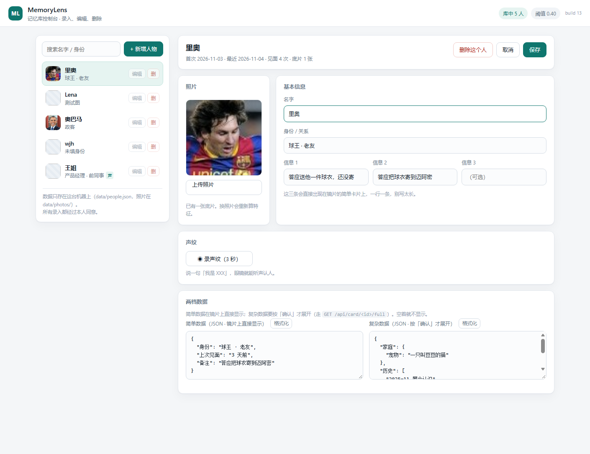

# 使用说明（给"上手就跑"的人）

这份文档只回答一件事：**我拿到这套东西，怎么在 10 分钟内跑起来、怎么在台上演**。
想改代码、想懂原理，看 [开发者文档](开发者文档.md)。

---

## 1. 这是什么

一副"记忆眼镜"：戴着它跟人打招呼，镜片上浮出这个人的名字、身份和你们之前聊过的事。

- 眼镜端：只负责**听 / 显示**，不拍照、不联网算东西（它就是个显示器）
- 电脑（之后是云）：识别声纹或人脸、查人脉库、把结果压成几行字
- 控制台：一个网页工作台，纯管理数据 —— 左边人脉库列表，右边编辑照片 / 名字 / 身份 / 信息 / 两档 JSON / 声纹。**页面上没有摄像头**

## 2. 你需要准备什么

| 东西 | 说明 |
|---|---|
| Python 3.12 | `start.bat` 会自动找（系统装没装都行，DSH 自带那个也能用） |
| 模型两个 | `models/yunet.onnx`（232KB）+ `models/arcface_mbf.onnx`（13MB）+ `models/campplus_zh_16k.onnx`（28MB），仓库里已经有 |
| 浏览器 | Edge / Chrome，控制台是纯网页 |
| 眼镜或模拟器 | 有真机最好；没有就用模拟器（需要 Docker + 开发包） |

## 3. 三条路，从简单到完整

### 路 A：只想看看效果（最省事）

双击 `start.bat`，浏览器自动打开 <http://127.0.0.1:8765>，看到的就是控制台：左边 5 个演示人物，点任意一行右边就出编辑表单。



想验识别（页面不再提供摄像头），用命令行丢一张图：

```powershell
python tools\try_face.py test\messi5.jpg     # known 里奥 sim=1.000
python tools\try_face.py test\biden.jpg      # unknown 陌生人
```

**只想验一句话的声纹**（不用摄像头、不用眼镜）：

```powershell
python tools\try_voice.py test\voice\huihui_b.wav     # 应该认成"王姐"，sim≈0.94
python tools\try_voice.py test\voice\zira_b.wav       # 应该是陌生人
```

### 路 B：跑真的眼镜模拟器

需要一个 Ubuntu 22.04 容器（Windows 上直接跑不通，见 [07-IrisView-工具包](docs/07-IrisView-工具包.md)）。
先把开发包放好（默认会去这些地方找，也可以用 `-Kit` 指定）：

```
E:\ar-memory\IrisView-Developer-Kit-v1.0.0-LLVISION-v2\IrisView-Developer-Kit-v1.0.0-LLVISION-v2\IrisView-Developer-Kit-v1.0.0
```

第一次要建镜像（约 5–10 分钟，之后不用）：

```powershell
docker build -f deploy\Dockerfile.irisview -t memorylens-irisview .
```

然后：

```powershell
# 1) 后端先起来（另开一个窗口，保持别关）
python src\server.py

# 2) 打包眼镜端（改了代码就必须先 build 再 package）
powershell -File tools\kit-docker.ps1 build
powershell -File tools\kit-docker.ps1 package

# 3) 起模拟器（会自动截图到 test/simulator.png）
powershell -File tools\kit-docker.ps1 run -WaitSec 30
```

模拟器窗口里右边是"眼镜控制台"（能点按钮、能看设备状态），左上角那块 640×480 的绿色画面
才是**真正的镜片**。中间那张彩色图是宣传图，不是实时画面。

### 路 C：真机

真机走的是 `irisview deploy`（adb 推到眼镜），包格式是 `.fuiapp`，产物在 `dist/memorylens.fuiapp`。
注意：**版本号必须比上一次大**，否则客户端会继续跑旧包（这个坑我们踩过两次）。

## 4. 控制台怎么用

左边是模块栏：**01 人物数据**（人脉库）和 **02 对话分析**（单人对话）。

### 4.1 模块 01 · 人物数据

页面右边那块。核心就五个动作：

| 想干什么 | 怎么做 |
|---|---|
| 加人 | 「+ 新增」→ 传一张正脸照 → 填名字/身份/信息 → 保存 |
| 改人 | 点条目上的「编辑」；**不换照片的话底片保留**，不用重新认 |
| 删人 | 点「删」，照片和底片一起删 |
| 录声纹 | 编辑某人 → 「◉ 录声纹（3 秒）」→ 说"我是王姐" → 保存（列表里会出现青色「声」标） |
| 写详情 | 编辑表单底部两个 JSON 框：**简单数据**（镜片直接显示）、**复杂数据**（按「确认」才展开） |

照片和声纹都是**可选**：只填名字也能建，只是这样只能靠控制台记，认不出人。

两个 JSON 框留空也能用：老数据会自动整理成 `{"身份": ..., "信息1": ...}`。

**简单数据**写什么：镜片上第一屏看到的，比如

```json
{ "身份": "产品经理 · 前同事", "上次见面": "上周三", "备注": "答应下周给报价单" }
```

**复杂数据**可以嵌套，服务端会自动摊平成一行行字：

```json
{
  "家庭": { "宠物": "一只叫豆豆的猫" },
  "历史": ["2025-11 展会认识", "2026-03 一起吃过饭"],
  "待办": "寄球衣"
}
```

### 4.2 模块 02 · 对话分析（单人）

先锁一个人，再录这一段对话，让大模型把"他答应了什么、偏好、近况"析出来，你勾选后写进档案。

**用之前要配一条"转写通道"和一条"文本模型"**。这两件事是分开的，因为不是每家都两样都有：

| 能力 | 可选 | 怎么配 |
|---|---|---|
| 转写（语音→文字） | 本地模型（推荐，免费离线）/ MiMo ASR / 任意 OpenAI 兼容 ASR | 见下 |
| 析出（文字→要点） | 任意 OpenAI 兼容 chat：MiMo、**DeepSeek**、OpenAI… | `AR_LLM_KEY` + `AR_LLM_PRESET` |

三种常见配法，选一种：

```powershell
# A. 全用小米 MiMo（最少配置）
$env:MIMO_API_KEY = "sk-小米密钥"
python src\server.py

# B. 转写用本地模型（不要 Key），析出用 DeepSeek
powershell -File tools\get_asr_model.ps1        # 只下一次，约 82MB
$env:DEEPSEEK_API_KEY = "sk-deepseek密钥"
$env:AR_LLM_PRESET = "deepseek"
python src\server.py

# C. 全用 DeepSeek 官方的对话接口 + OpenAI 的 whisper 转写
$env:AR_ASR_PROVIDER = "http"
$env:AR_ASR_BASE = "https://api.openai.com/v1"
$env:AR_ASR_KEY = "sk-openai密钥"
$env:AR_ASR_MODEL = "whisper-1"
$env:DEEPSEEK_API_KEY = "sk-deepseek密钥"
$env:AR_LLM_PRESET = "deepseek"
python src\server.py
```

> **DeepSeek 目前没有语音识别接口**，只有对话（`deepseek-chat` / `deepseek-reasoner`），所以"转写用 DeepSeek"这条路走不通——要么用本地模型，要么用别家的 ASR。析出用 DeepSeek 完全没问题，`AR_LLM_PRESET=deepseek` 就是为它准备的（base `https://api.deepseek.com/v1`，模型 `deepseek-chat`）。

配置不全会**明确告诉你缺哪一半**：只配了本地转写没配文本模型时，横幅会说"能录音能转写，只是「分析」按不动"，而不是一概说"用不了"。

**流程**

| 步 | 做什么 | 说明 |
|---|---|---|
| 1 | 左边点一个人 → 变红「已锁定」 | 只做单人；多人谈话是另一个模块 |
| 2 | 「◉ 开始录音」 | 全局录音，每 6 秒自动送一段去转写，文字实时出现在下面 |
| 3 | 「■ 停止」 | 会把最后一段补完 |
| 4 | 「分析这段对话」 | 模型给出概括 + 最多 6 条要点，每条带原话依据 |
| 5 | 勾选要留的 → 「写入档案」 | 写进这个人的**复杂数据 → 对话要点**，同时留一条对话记录 |

没有麦克风也能试：直接把对话原文粘进转写框，按「分析这段对话」即可（这也是最快验证模型 Key 通不通的办法）。

不想花额度时，可以用 `AR_LLM_STUB=1` 起一个假模型实例，返回的数据会标注 `stub`。

## 5. 眼镜上只有三个动作

平台只给「上/下/左/右/确认/返回」这 6 个动作，**没有双击、没有长按**，所以：

| 屏幕现在是 | 按「确认」 | 按「返回」 |
|---|---|---|
| 空的 | 开始录音（说完自动识别） | — |
| 简单卡片 | 拉详情，翻到复杂数据 | 清屏 |
| 详情页 | 收起来，回简单卡片 | 清屏 |

一屏 6 行，内容多了会自己往下滚，页脚显示 `1/2`。

## 6. 台上的 3 分钟

1. **开场**：戴着眼镜，说一句"我不认识面前这个人"——镜片空着。
2. **陌生**：对队友说声"你好"，镜片显示 `陌生的声音 / 按一下 · 去控制台新增`。
3. **录入**：打开控制台点「+ 新增人物」，传队友照片 + 录 3 秒声纹 + 填两条信息，保存。
4. **再说一遍**：同一个人再说话，镜片浮出名字 + 身份 + 两条信息（这就是高潮）。
5. **按确认**：翻到详情页，"哦对，我答应过你一件事"——展示复杂数据和隐私闸门。
6. **兜底**：如果现场太吵声纹认不准，切手机拍照走人脸通道（同一个库、同一张卡片）。

## 7. 出问题了先看这几条

| 现象 | 原因 / 怎么办 |
|---|---|
| 镜片显示「后台没连上」 | 后端没起，或容器里连不到宿主：容器要用 `--add-host host.docker.internal:host-gateway` |
| 改了代码但画面没变 | 没 bump `versionCode`，客户端继续跑旧包 |
| 镜片只有一两行字 | 单个 Text 只能画约 110px，内容要短、要分块（细节见开发者文档） |
| 认错人 | 现场噪音大：声纹要求 0.72 分且比第二名高 0.08；可以让对方再说一句，或改用人脸 |
| 麦克风录不了声纹 | 被别的软件占了（微信/钉钉）或浏览器没给权限，换 Edge 再试 |
| 端口被占 | 换端口：`set AR_PORT=8790` 再启动；眼镜端用 `MEMORYLENS_BACKEND` 指过去 |

## 8. 数据在哪、怎么备份

- 全部数据在 `data/people.json`（一个文件，记事本可读）
- 照片在 `data/photos/<id>.jpg`
- 备份：整个 `data/` 拷走即可；删库：删掉这两个东西，重启服务会自动建空库
